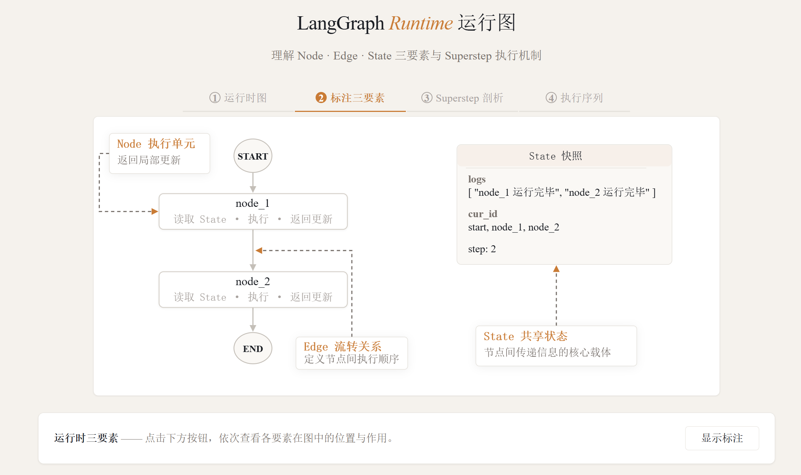
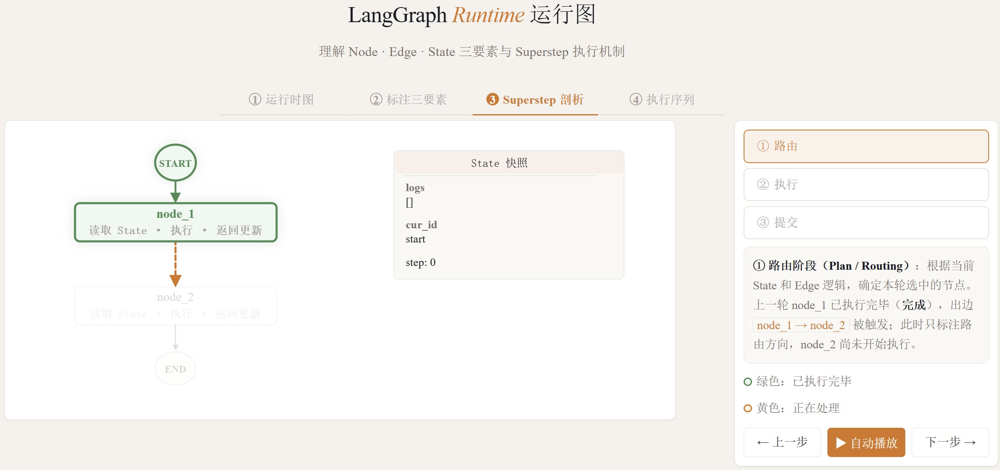
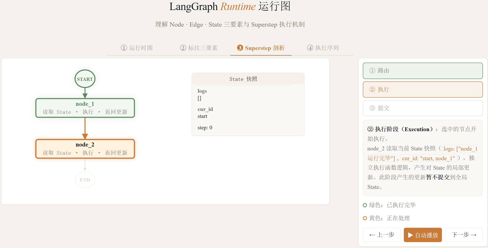
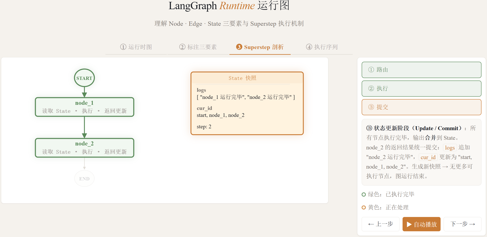

# 一、简介

- LangGraph 是一个<font color="red">**用于组织和执行复杂图计算流程的框架**</font>。其底层运行逻辑基于 Google 发表的 Pregel 计算模型，核心思想是<font color="red">**将 Agent 的执行过程抽象为一张由节点和边组成的有向图**</font>。

- 在实际开发中，大语言模型本身已经非常成熟，开发者需要做的是<font color="red">**将整个计算流程编排好**</font>——先调用谁、后调用谁、数据如何流转。LangGraph 就是用来解决这个编排问题的


## 1、定位

- LangChain 1.x 的定位发生了明显变化：旧式 Chain、Retriever、Memory 等组件被迁移至 langchain‑classic；LCEL 保留为 langchain‑core 的底层组合机制，但不再是主要开发入口。
- LangChain 1.x 现在聚焦于 Agent 开发，核心入口是 create_agent，围绕 Agent 提供模型、工具、消息、结构化输出、Middleware 和记忆管理等高层抽象。
- LangGraph 是更底层的编排框架与 Agent Runtime，负责复杂工作流和有状态 Agent 的执行，提供持久化、流式输出、Durable Execution、Human‑in‑the‑loop 等运行时能力。create_agent 底层基于 LangGraph 实现

- LangGraph 与 LangChain 的关系

  - 两者并非对立，而是<font color="red">**协同工作**</font>的关系：

  | 框架      | 定位             | 适用场景                         |
  | --------- | ---------------- | -------------------------------- |
  | LangChain | 顶层应用层设计   | 快速上手、简单直观的 Agent 构建  |
  | LangGraph | 底层源码架构编排 | 复杂逻辑、持久化检查点、人机协同 |

  - LangGraph 与 LangChain 的对比


| 对比维度 | LangChain             | LangGraph                                |
| -------- | --------------------- | ---------------------------------------- |
| 定位     | Agent 高层开发框架    | 底层编排框架 & Agent Runtime             |
| 核心入口 | create_agent          | StateGraph / @entrypoint                 |
| 适用场景 | 结构直接的 Agent 应用 | 复杂工作流、持久化、长时间运行、人工介入 |
| 流程控制 | Agent 循环自动管理    | 精细控制节点、边、条件分支               |
| 学习成本 | 较低                  | 较高（但能力上限更高）                   |

  - <font color="red">**LangChain 提供易于使用的 Agent 高层抽象，LangGraph 提供可靠、可持久化且可精细控制的底层执行能力**</font>
  - 对于大多数 Agent 项目，从 LangChain 的 create_agent 开始即可；需要复杂工作流编排、确定性步骤与 Agent 步骤混合、长时间运行或底层状态控制时，再引入 LangGraph


## 2、构成图的三要素

- 构成 LangGraph 图的三个基本要素：<font color="red">**State（状态）、Node（节点）、Edge（边）**</font>

- <font color="red">**State（状态）**</font>

  - State 是 LangGraph 中最核心的概念，它表示<font color="red">**图运行过程中的所有数据**</font>
  - <font color="red">**关键理解**</font>：不要被"状态"这个中文翻译误导，它本质上就是<font color="red">**数据容器**</font>

  - State 承载的内容包括：

    - <font color="red">**上下文信息**</font>：当前运行到哪一步、接下来要执行什么

    - <font color="red">**中间结果**</font>：某个节点执行完毕后的输出数据

    - <font color="red">**后续节点需要读取的数据**</font>：传递给下游节点的输入

  - 一句话总结：在 LangGraph 运行过程中，所有数据都存储在 State 里面。

- <font color="red">**Node（节点）**</font>

  - 节点是图中的<font color="red">**一个执行单元**</font>，通常实现为一个函数
  - 节点会读取当前 State，执行相应的业务逻辑，并返回对 State 的局部更新。节点本身并不直接修改全局状态，状态的合并与提交由运行时统一完成。

  - 如果一个 Agent 只需要调用一次大模型，那就不需要构建图。正因为 Agent 内部的逻辑和流程非常复杂，才需要多个节点组合起来构成图。<font color="red">**每个节点负责完成一个具体的操作**</font>，比如调用某个大模型、处理数据、执行工具等。

- <font color="red">**Edge（边）**</font>

  - 边表示<font color="red">**节点与节点之间的流转关系**</font>，定义了执行的先后顺序。
  - Edge 可以是固定流转，也可以根据当前 State 进行条件判断，从而实现分支、循环等复杂控制流程。

  - 最简单的图结构：START -> Node 1 -> Node 2 -> END，其中每一条箭头就是一条边。边不仅定义了顺序，后续还可以包含条件判断逻辑，实现分支和并行。




## 3、图运行过程

- 超步（SuperStep）：LangGraph 的图在运行时，被拆分成一个一个的<font color="red">**SuperStep（超步）**</font>。<font color="red">**超步是图运行的最小组成单元**</font>，每个超步处理一个节点，由三个阶段组成。

- 超步的三个阶段

  - 阶段1：路由（Routing）：当一个节点执行完成后，路由阶段决定<font color="red">**接下来要执行哪个节点**</font>
    - 对于简单线性结构：直接指向下一个节点
    - 对于复杂结构：可能有多个候选节点（并行执行）或条件判断（选择执行）
    - 边的逻辑在这一阶段被触发，确定下一步的执行目标

  

  - 阶段2：执行（Execution）：确定目标节点后，开始<font color="red">**执行该节点的代码逻辑**</font>

    - **输入**：读取当前的 State 快照作为参数
    - **处理**：运行节点内部的函数逻辑
    - **输出**：产生局部更新（此时不提交到全局状态）

    - 关键点：执行阶段产生的更新是<font color="red">**局部的**</font>，不会立即影响全局状态。

  

  - 阶段3：提交（Commit）：将节点执行过程中产生的数据更新<font color="red">**合并到全局状态**</font>中
    - 将日志、执行内容、当前执行的节点 ID 等信息统一提交
    - 更新全局 State，供后续节点读取
    - 这一步完成后，一个超步才算真正结束

  

- 开始与结束的例外
  - **开始**：从 START 标记直接进入第一个节点，不经过完整超步
  - **结束**：当节点连接到 END 标记时，图运行结束

- 检查点（Checkpoint）：检查点是图运行过程中的<font color="red">**状态保存机制**</font>，类似于在不同位置拍照记录当前状态。它用于：

  - 持久化保存运行过程中的状态数据

  - 支持中断恢复和状态回溯

  - 后续课程会详细讲解


## 4、API分类

- LangGraph 提供了两种不同的 API 来构建运行图：<font color="red">**Graph API（图式 API）**</font> 和 <font color="red">**Functional API（函数式 API）**</font>。这两种 API 共享相同的底层运行时，可以在同一应用程序中协同使用，但它们针对不同的使用场景和开发偏好而设计。


### 3.1 图式 API

- Graph API 采用声明式方式构建工作流。开发者需要显式定义 State、Node 和 Edge，<font color="red">**将业务流程组织成一个可可视化的图结构**</font>

- 当流程中存在较复杂的分支、多个节点之间共享状态、并行执行、结果汇聚，或者需要通过图结构帮助调试和团队协作时，更适合使用 Graph API。官方文档也明确建议，在需要复杂流程可视化、显式状态管理、多条件分支、并行路径以及团队协作时，优先选择 Graph API。

- 总之：<font color="red">**Graph API 更适合构建结构清晰、节点关系复杂、需要长期维护的工作流**</font>

- 典型场景包括：

| 场景               | 说明                                               |
| ------------------ | -------------------------------------------------- |
| 多节点复杂流程     | 流程中存在多个处理节点，需要清晰表达节点之间的关系 |
| 条件分支较多       | 根据 State 中的不同字段决定后续执行路径            |
| 并行执行与结果汇聚 | 多个节点并行运行，之后汇总结果                     |
| 多组件共享状态     | 多个节点都需要读写同一个全局 State                 |
| 需要图结构展示     | 便于调试、讲解、文档化和团队协作                   |


### 3.2 Functional API

- Functional API 采用<font color="red">**命令式方式构建工作流**</font>，更贴近普通 Python 函数调用。开发者可以使用 @entrypoint 定义工作流入口，使用 @task 定义可做检查点记录的任务，然后在函数内部直接使用普通的 if/else、循环和函数调用来编排流程。官方文档指出：当已有过程式代码尽量少改动、流程以线性为主、分支逻辑简单、希望快速做原型验证时，优先 Functional API。

- 可以这样理解：Functional API 更适合在普通 Python 函数流程里，低成本接入 LangGraph 的持久化、中断恢复、任务检查点能力。

- 典型场景包括：

| 场景           | 说明                                          |
| -------------- | --------------------------------------------- |
| 现有代码改造   | 已有函数式 / 过程式代码，不想完整重构成图结构 |
| 线性流程       | 主要按 A → B → C 顺序执行                     |
| 简单分支       | 只有少量 if/else 判断                         |
| 快速原型验证   | 减少样板代码，快速跑通业务逻辑                |
| 局部任务持久化 | 希望部分函数作为独立 task 做检查点记录        |


### 3.3 二者的核心区别

| 对比项     | Graph API                      | Functional API                 |
| ---------- | ------------------------------ | ------------------------------ |
| 编程风格   | 声明式图结构                   | 命令式函数流程                 |
| 核心抽象   | State、Node、Edge              | entrypoint、task               |
| 状态管理   | 显式定义全局 State             | 更多依靠函数参数、返回值       |
| 流程表达   | 通过节点和边来表达             | 用原生 Python 控制流表达       |
| 可视化能力 | 强，天然支持绘图调试           | 弱，和普通代码一样             |
| 适合场景   | 复杂工作流、多分支、多节点协作 | 简单流程、快速原型、旧代码迁移 |
| 学习成本   | 相对更高                       | 相对更低                       |


# 二、图的基本构建与运行

## 1、入门案例

### 1.1 项目依赖

- 创建项目，导入依赖

~~~bash
# 创建项目
uv init LangGraphDemo
# 添加依赖
uv add langgraph
~~~


### 1.2 定义状态图步骤

- 状态图的定义可以分为以下几个步骤：
  - <font color="red">**1. 定义全局状态**</font> 定义整个运行图共享的全局状态（实际上，除了全局状态，LangGraph还支持其它类型的状态，下文详述）
  - <font color="red">**2. 创建状态图**</font> 创建 StateGraph实例，将状态和状态图绑定
  - <font color="red">**3. 定义图结构**</font> 定义节点和边并添加到状态图中


#### 1.2.1 定义全局状态

- <font color="red">**全局状态是 LangGraph 运行图每个节点都可以访问的公共对象**</font>

~~~python
class OverAllState(TypedDict):
    logs: Annotated[list[str], add]
    cur_id: str
~~~


#### 1.2.2 创建状态图

~~~python
builder = StateGraph(state_schema=OverAllState)
~~~


#### 1.2.3 定义图结构

~~~python
def node_1(state: OverAllState) -> OverAllState:
    pre_id = state["cur_id"]
    return {
        "logs": ["node_1 运行完毕"],
        "cur_id": pre_id + ", node_1"
    }

def node_2(state: OverAllState) -> OverAllState:
    pre_id = state["cur_id"]
    return {
        "logs": ["node_2 运行完毕"],
        "cur_id": pre_id + ", node_2"
    }
~~~


#### 1.2.4 添加节点

~~~python
builder.add_node("node_1", node_1)
builder.add_node("node_2", node_2)
~~~


#### 1.2.5 添加边

~~~python
builder.add_edge(START, "node_1")
builder.add_edge("node_1", "node_2")
builder.add_edge("node_2", END)
~~~


#### 1.2.6 编译状态图

- 将上一步得到的状态图编译为可执行的运行图

~~~python
graph = builder.compile()
~~~


#### 1.2.7 调用状态图

- 可以通过invoke调用计算图

~~~python
print(graph.invoke({"cur_id": "start"}))
~~~


### 1.3 总体代码

~~~python
from langgraph.graph import StateGraph, START, END
from typing import TypedDict, Annotated
from operator import add


# ============================================================
# 第一步：定义状态
# ============================================================
class OverAllState(TypedDict):
    # 日志字段：类型为 list[str]，更新方式为 add（追加）
    logs: Annotated[list[str], add]
    # 当前流程位置字段：类型为 str，默认覆盖更新
    cur_id: str


# ============================================================
# 第二步：定义节点
# ============================================================
def node_1(state: OverAllState) -> OverAllState:
    """节点1：在日志中追加记录，拼接当前ID"""
    pre_id = state["cur_id"]
    return {
        "logs": ["node_1 运行完毕"],
        "cur_id": pre_id + ", node_1"
    }

def node_2(state: OverAllState) -> OverAllState:
    """节点2：在日志中追加记录，拼接当前ID"""
    pre_id = state["cur_id"]
    return {
        "logs": ["node_2 运行完毕"],
        "cur_id": pre_id + ", node_2"
    }


# ============================================================
# 第三步：定义边（构建图）
# ============================================================
# 3.1 创建图的建造者
builder = StateGraph(state_schema=OverAllState)

# 3.2 添加节点
builder.add_node(node_1)
builder.add_node(node_2)

# 3.3 添加边（定义执行顺序）
builder.add_edge(START, "node_1")      # 开始 -> 节点1
builder.add_edge("node_1", "node_2")   # 节点1 -> 节点2
builder.add_edge("node_2", END)        # 节点2 -> 结束

# ============================================================
# 第四步：编译图
# ============================================================
graph = builder.compile()

# ============================================================
# 第五步：运行图
# ============================================================
result = graph.invoke({"cur_id": "start"})
print(result)
# 输出: {'logs': ['node_1 运行完毕', 'node_2 运行完毕'], 'cur_id': 'start, node_1, node_2'}
~~~

- **代码解读**：

  - **状态定义部分**：

    - TypedDict：Python 内置的类型化字典，LangGraph 官方推荐的状态定义方式

    - Annotated[list[str], add]：第一个参数 list[str] 是字段的数据类型，第二个参数 add 是 reducer 函数，表示该字段更新时采用追加方式而非覆盖

    - cur_id: str：普通字符串字段，没有指定 reducer，更新时默认覆盖

  - **节点定义部分**：

    - 节点本质上是普通 Python 函数

    - 参数 state 是当前状态的快照，类型为 OverAllState

    - 返回值是字典形式，只包含需要更新的字段（部分更新）

    - logs 字段因为配置了 add reducer，返回值会被追加到已有列表中

    - cur_id 字段没有配置 reducer，返回值会覆盖旧值

  - **边定义部分**：

    - 使用建造者模式：先创建 StateGraph 获取 builder

    - add_node 添加节点到图中

    - add_edge 定义节点间的连接关系，参数为字符串形式的节点名称

    - START 和 END 是 LangGraph 内置的特殊标记

  - **运行结果分析**：

    - logs 字段：['node_1 运行完毕', 'node_2 运行完毕'] — 两个节点的日志被追加合并

    - cur_id 字段：'start, node_1, node_2' — 手动拼接的结果


## 2、图结构可视化

### 2.1 Mermaid方式

- mermaid是一种生成图表和流程图的文本标记语言，它可以把简单的文本描述直接渲染成可视化图形。
  - 通过以下代码可以用mermaid语法表达图结构，并打印mermaid源码

~~~python
# 获取 Mermaid 语法的图结构源码
raw_mermaid = graph.get_graph().draw_mermaid()
print(raw_mermaid)
~~~

- 完整代码

~~~python
from langgraph.graph import StateGraph, START, END
from typing import TypedDict, Annotated
from operator import add


# ============================================================
# 第一步：定义状态
# ============================================================
class OverAllState(TypedDict):
    # 日志字段：类型为 list[str]，更新方式为 add（追加）
    logs: Annotated[list[str], add]
    # 当前流程位置字段：类型为 str，默认覆盖更新
    cur_id: str


# ============================================================
# 第二步：定义节点
# ============================================================
def node_1(state: OverAllState) -> OverAllState:
    """节点1：在日志中追加记录，拼接当前ID"""
    pre_id = state["cur_id"]
    return {
        "logs": ["node_1 运行完毕"],
        "cur_id": pre_id + ", node_1"
    }

def node_2(state: OverAllState) -> OverAllState:
    """节点2：在日志中追加记录，拼接当前ID"""
    pre_id = state["cur_id"]
    return {
        "logs": ["node_2 运行完毕"],
        "cur_id": pre_id + ", node_2"
    }


# ============================================================
# 第三步：定义边（构建图）
# ============================================================
# 3.1 创建图的建造者
builder = StateGraph(state_schema=OverAllState)

# 3.2 添加节点
builder.add_node(node_1)
builder.add_node(node_2)

# 3.3 添加边（定义执行顺序）
builder.add_edge(START, "node_1")      # 开始 -> 节点1
builder.add_edge("node_1", "node_2")   # 节点1 -> 节点2
builder.add_edge("node_2", END)        # 节点2 -> 结束

# ============================================================
# 第四步：编译图
# ============================================================
graph = builder.compile()

# ============================================================
# 第五步：运行图
# ============================================================
result = graph.invoke({"cur_id": "start"})
print(result)
# 输出: {'logs': ['node_1 运行完毕', 'node_2 运行完毕'], 'cur_id': 'start, node_1, node_2'}


# ============================================================
# 第六步：获取 Mermaid 语法的图结构源码
# ============================================================
raw_mermaid = graph.get_graph().draw_mermaid()
print(raw_mermaid)
~~~

- **代码解读**：graph.get_graph() 获取图结构对象，.draw_mermaid() 将其转换为 Mermaid 语法字符串。Mermaid 是一种文本格式的图表描述语言，支持在 Markdown 文档中直接渲染
- 输出源码

~~~bash
---
config:
  flowchart:
    curve: linear
---
graph TD;
	__start__([<p>__start__</p>]):::first
	node_1(node_1)
	node_2(node_2)
	__end__([<p>__end__</p>]):::last
	__start__ --> node_1;
	node_1 --> node_2;
	node_2 --> __end__;
	classDef default fill:#f2f0ff,line-height:1.2
	classDef first fill-opacity:0
	classDef last fill:#bfb6fc
~~~

- 将 graph TD 节点粘贴为代码，格式为mermaid

~~~mermaid
graph TD;
	__start__([<p>__start__</p>]):::first
	node_1(node_1)
	node_2(node_2)
	__end__([<p>__end__</p>]):::last
	__start__ --> node_1;
	node_1 --> node_2;
	node_2 --> __end__;
	classDef default fill:#f2f0ff,line-height:1.2
	classDef first fill-opacity:0
	classDef last fill:#bfb6fc
~~~


### 2.2 保存本地

- 将图保存为本地 PNG 文件

~~~python
# 将图保存为本地 PNG 文件
png_bytes = graph.get_graph().draw_mermaid_png()
png_filename = 'D:/kn/AI/first_demo_graph.png'
with open(png_filename, "wb") as f:
    f.write(png_bytes)
~~~

- 全部代码

~~~python
from tkinter import Image

from langgraph.graph import StateGraph, START, END
from typing import TypedDict, Annotated
from operator import add


# ============================================================
# 第一步：定义状态
# ============================================================
class OverAllState(TypedDict):
    # 日志字段：类型为 list[str]，更新方式为 add（追加）
    logs: Annotated[list[str], add]
    # 当前流程位置字段：类型为 str，默认覆盖更新
    cur_id: str


# ============================================================
# 第二步：定义节点
# ============================================================
def node_1(state: OverAllState) -> OverAllState:
    """节点1：在日志中追加记录，拼接当前ID"""
    pre_id = state["cur_id"]
    return {
        "logs": ["node_1 运行完毕"],
        "cur_id": pre_id + ", node_1"
    }

def node_2(state: OverAllState) -> OverAllState:
    """节点2：在日志中追加记录，拼接当前ID"""
    pre_id = state["cur_id"]
    return {
        "logs": ["node_2 运行完毕"],
        "cur_id": pre_id + ", node_2"
    }


# ============================================================
# 第三步：定义边（构建图）
# ============================================================
# 3.1 创建图的建造者
builder = StateGraph(state_schema=OverAllState)

# 3.2 添加节点
builder.add_node(node_1)
builder.add_node(node_2)

# 3.3 添加边（定义执行顺序）
builder.add_edge(START, "node_1")      # 开始 -> 节点1
builder.add_edge("node_1", "node_2")   # 节点1 -> 节点2
builder.add_edge("node_2", END)        # 节点2 -> 结束

# ============================================================
# 第四步：编译图
# ============================================================
graph = builder.compile()

# ============================================================
# 第五步：运行图
# ============================================================
result = graph.invoke({"cur_id": "start"})
print(result)
# 输出: {'logs': ['node_1 运行完毕', 'node_2 运行完毕'], 'cur_id': 'start, node_1, node_2'}

# ============================================================
# 将图保存为本地 PNG 文件
# ============================================================
png_bytes = graph.get_graph().draw_mermaid_png()
png_filename = 'D:/kn/AI/first_demo_graph.png'
with open(png_filename, "wb") as f:
    f.write(png_bytes)
~~~


# 三、状态(State)管理

##  1、状态定义

- 状态的定义实际上是在声明状态的 Schema，后者是状态字段的完整描述。 
- 官方推荐了三种定义 Schema 的方式：TypedDict、dataclass、Pydantic


### 1.1 TypedDict方式

- TypedDict 是 Python 内置的类型化字典，使用字典语法访问字段。LangGraph 官方推荐的首选方式

~~~python
from langgraph.graph import StateGraph, START, END
from typing import TypedDict, Annotated
from operator import add


class OverAllState(TypedDict):
    logs: Annotated[list[str], add]
    cur_id: str


def node_1(state: OverAllState) -> OverAllState:
    pre_id = state["cur_id"]
    return {
        "logs": ["node_1 运行完毕"],
        "cur_id": pre_id + ", node_1"
    }


def node_2(state: OverAllState) -> OverAllState:
    pre_id = state["cur_id"]
    return {
        "logs": ["node_2 运行完毕"],
        "cur_id": pre_id + ", node_2"
    }


builder = StateGraph(state_schema=OverAllState)
builder.add_node("node_1", node_1)
builder.add_node("node_2", node_2)
builder.add_edge(START, "node_1")
builder.add_edge("node_1", "node_2")
builder.add_edge("node_2", END)

graph = builder.compile()
print(graph.invoke({"cur_id": "start"}))
~~~

- 输出：{'logs': ['node_1 运行完毕', 'node_2 运行完毕'], 'cur_id': 'start, node_1, node_2'}


### 1.2 dataclass方式

- 属性调用方式由 ['字段名'] 变为 <font color='red'>**.字段名**</font>

~~~python
from langgraph.graph import StateGraph, START, END
from typing import Annotated
from dataclasses import dataclass
from operator import add


@dataclass
class OverAllState:
    logs: Annotated[list[str], add]
    cur_id: str


def node_1(state: OverAllState) -> OverAllState:
    pre_id = state.cur_id
    return OverAllState(
        logs=state.logs + ["node_1 运行完毕"],
        cur_id=pre_id + ", node_1"
    )


def node_2(state: OverAllState) -> OverAllState:
    pre_id = state.cur_id
    return OverAllState(
        logs=state.logs + ["node_2 运行完毕"],
        cur_id=pre_id + ", node_2"
    )


builder = StateGraph(state_schema=OverAllState)
builder.add_node("node_1", node_1)
builder.add_node("node_2", node_2)
builder.add_edge(START, "node_1")
builder.add_edge("node_1", "node_2")
builder.add_edge("node_2", END)


graph = builder.compile()
print(graph.invoke({"cur_id": "start"}))
~~~

- @dataclass 是 Python 的装饰器，用于自动生成 __init__、__repr__ 等方法
- 使用点号（.）方式访问属性，而非字典的中括号方式
- 返回时可以返回字典，LangGraph 会自动处理转换
- 也可以返回 dataclass 实例


### 1.3 Pydantic方式

- Pydantic 的 BaseModel 提供数据校验能力，字段访问方式与 dataclass 相同（点号访问）

~~~python
from langgraph.graph import StateGraph, START, END
from typing import Annotated
from pydantic import BaseModel
from operator import add

# 1. 定义状态（使用 Pydantic BaseModel）
class OverAllState(BaseModel):
    logs: Annotated[list[str], add]
    cur_id: str

# 2. 定义节点
def node_1(state: OverAllState) -> OverAllState:
    pre_id = state.cur_id
    return {
        "logs": ["node_1 运行完毕"],
        "cur_id": pre_id + ", node_1"
    }

def node_2(state: OverAllState) -> OverAllState:
    pre_id = state.cur_id
    return {
        "cur_id": pre_id + ", node_2"
    }

# 3. 定义边
builder = StateGraph(state_schema=OverAllState)
builder.add_node(node_1)
builder.add_node(node_2)
builder.add_edge(START, "node_1")
builder.add_edge("node_1", "node_2")
builder.add_edge("node_2", END)

graph = builder.compile()

# 4. 运行（可以传字典，Pydantic 会自动解析）
result = graph.invoke({"cur_id": "start"})
print(result)
# 输出: {'logs': ['node_1 运行完毕'], 'cur_id': 'start, node_1, node_2'}
~~~

- 使用 BaseModel 作为状态类的父类
- 字段访问使用点号方式 state.cur_id
- invoke 时传入字典，Pydantic 会自动解析为模型对象
- 注意输出中 logs 只有 node_1 的记录，因为 node_2 没有返回 logs 字段，而 Pydantic 不会保留未更新的字段默认值


### 1.4 总结

- 在 LangGraph 中，三种方式都有字段校验，但校验机制不同：

| 方式          | 校验行为                             | 异常类型        |
| ------------- | ------------------------------------ | --------------- |
| **TypedDict** | 将字段视为字典 Key，Key 不匹配抛异常 | KeyError        |
| **dataclass** | 将字段视为类属性，属性不匹配抛异常   | TypeError       |
| **Pydantic**  | 字段不匹配抛异常                     | ValidationError |

- **重要区别**：在 LangChain 中只有 Pydantic 有严格校验；但在 LangGraph 中，三种方式都会进行校验。

- 节点返回字段与状态字段不匹配时
  - 如果节点返回的字段名与状态定义的字段名不匹配，三种方式的行为是统一的：**该更新会被忽略**，不会影响全局状态。

- 推荐使用 TypedDict 的原因

  - **功能无差异**：三种方式在 LangGraph 中都会进行字段校验

  - **更贴近状态更新机制**：LangGraph 的状态更新本质上是字典更新，TypedDict 最自然

  - **轻量级**：不引入额外的数据校验开销

  - **官方首选**：大多数官方文档和示例都使用 TypedDict

  - **简洁清晰**：写法最简洁，结构最清晰
  - 总结：相比普通 dict，TypedDict 可以提供更明确的字段约束和类型提示；相比 dataclass，TypedDict 更贴近 LangGraph 中状态的更新方式，因为节点通常返回的是表示“部分状态更新”的字典，而不是完整对象；相比 Pydantic BaseModel，它又更加轻量，不会引入额外的数据校验开销。因此，在没有复杂校验需求的情况下，TypedDict 是定义 LangGraph State Schema 的首选方式


## 2、状态合并

### 2.1 什么是Reducer

- State Reducer 是 LangGraph 中用于<font color="red">**合并状态更新的核心机制**</font>。在 LangGraph 的 stateGraph 中，每个节点可以读取和写入共享状态，而 Reducer 定义了如何<font color="red">**将多个节点对同一状态键的更新合并**</font>

- **Reducer 的核心特征：**

  - <font color="red">**函数签名**</font>：(value, value) -> value，接收当前值和更新值，返回合并后的新值
  - <font color="red">**注解定义**</font>：通过 Annotated[Type, reducer_function] 为状态键指定 Reducer

  - <font color="red">**默认行为**</font>：未指定 Reducer 的状态键使用覆盖策略（Last‑Write‑Wins）


### 2.2 如何定义Reducer

#### 2.2.1 定义Reducer

- Reducer 本质上是一个二元合并函数，用于定义当同一个字段产生多个更新值时，LangGraph 应该如何将这些值合并为一个最终结果

- 函数签名：(Value, Value) -> Value
- 示例代码如下：

~~~python
def my_reducer(left: list[str], right: list[str]) -> list[str]:
    return left + right

left = ['a', 'b']
right = ['c']
print(my_reducer(left, right))
~~~

- 其中，my_reducer 用于处理 list[str] 类型的数据。它接收两个列表参数：

  - left：当前已累计的状态值；

  - right：本次待合并的新值。

- 函数内部通过 left + right 将两个列表合并，并返回合并后的结果。

- 因此，该 Reducer 的作用是：<font color='red'>**当某个状态字段存在多次列表更新时，将这些列表内容追加合并，而不是直接覆盖原值。**</font>

- 运行结果如下

~~~bash
['a', 'b', 'c']
~~~


#### 2.2.2 将Reducer和状态字段关联

- 在 LangGraph 中，Reducer 通常通过 Python 的 typing.Annotated 与状态字段进行关联。

- Annotated[] 是 Python 提供的一种类型注解扩展机制，<font color='red'>**用于在原始类型之外附加额外的元数据信息**</font>。需要注意的是，Annotated[] 本身并不规定这些元数据的具体含义，它只负责在类型注解中保留这些信息。

- 严格来说，Annotated 的第一个参数是被注解的原始类型，后续参数是附加的元数据。至于这些元数据表示什么、如何解析，则由使用它的框架或工具自行决定。

- 在 LangGraph 中，框架利用这一机制，将状态字段的类型和 Reducer 规则同时声明在字段定义中。其基本形式如下：

```python
Annotated[Type, reducer_function]
```

- 其中：

  - Type：表示状态字段的数据类型；

  - reducer_function：表示该字段对应的 Reducer 函数。

- 示例代码如下：

```python
from typing import TypedDict, Annotated

class OverAllState(TypedDict):
    logs: Annotated[list[str], my_reducer]
    cur_id: str
```

- 在上述代码中：

  - logs 字段的类型是 list[str]；

  - my_reducer 是与 logs 字段关联的 Reducer 函数；

  - 当多个节点同时更新 logs 字段时，LangGraph 会使用 my_reducer 将多个列表合并；

  - cur_id 字段没有指定 Reducer，因此采用默认更新规则。


#### 2.2.3 常用内置Reducer函数

- ###### <font color="red">**operator.add**</font>

  - operator.add 是 Python 内置的加法操作函数，底层由 C 实现

  - 它接收两个参数，等价于 a（第一个参数）+ b（第二个参数）

  - 代码如下

  ```python
  from operator import add
  
  print(f"{add(1,2) = }")
  print(f"{add([1,2], [3,4]) = }")
  print(f"{add(['a','b'], ['c']) = }")
  ```

  - 输出如下

  ```bash
  add(1,2) = 3
  add([1,2], [3,4]) = [1, 2, 3, 4]
  add(['a','b'], ['c']) = ['a', 'b', 'c']
  ```

- <font color="red">**langgraph.graph.message.add_messages**</font>

  - add_messages 是 LangGraph 中专用于合并消息列表的 Reducer 函数，常用于维护对话历史类的状态字段。其函数签名如下

  ~~~python
  def add_messages(
      left: Messages,
      right: Messages,
      *,
      format: Literal["langchain-openai"] | None = None,
  ) -> Messages:
      ...
      return merged
  ~~~

  - 参数说明：
    - left：状态中已有的消息列表；
    - right：当前节点返回的消息更新值；
    - format：可选参数，用于指定返回消息的格式，通常无需手动设置

  - <font color="red">**left 与 right 的类型均为 Messages**</font>。Messages 可以理解为 LangChain 消息对象的列表，其中每个元素都是 BaseMessage 或其子类的实例，常见子类包括：

    - HumanMessage：用户的输入消息；
    - AIMessage：AI 的回复消息；
    - SystemMessage：系统提示消息；
    - ToolMessage：工具调用的结果消息。

  - <font color="red">**add_messages 处理的是对话消息序列，而非普通的字符串列表**</font>

  - BaseMessage 包含一个可选的 id 属性，用于唯一标识一条消息。add_messages 在合并 left 与 right 时，不是简单地执行列表拼接，而是依据消息的 id 进行合并：

    - 若 right 中的某条消息的 id 在 left 中不存在，则将该消息追加到结果列表末尾；
    - 若 right 中的某条消息的 id 与 left 中已有消息的 id 相同，则使用 right 中的新消息替换 left 中的旧消息。

  - 因此，add_messages 的作用可以概括为：<font color="red">**在保留历史消息的基础上追加新消息，并允许通过相同的消息 id 覆盖已有消息**</font>。

    - 需要特别说明，add_messages 并非简单地对 left 与 right 求“并集”。更准确地说，它是一个基于消息 id 的消息列表合并函数：既支持追加新消息，也支持更新已有消息。
    - 可以理解为：

    ~~~python
    merged = left + right
    ~~~

    - 但若 right 中存在与 left 相同 id 的消息，则最终结果中不会出现重复消息，而是用 right 中的消息覆盖 left 中对应的旧消息

  - 示例代码如下

  ~~~python
  from langgraph.graph.message import add_messages
  from langchain.messages import HumanMessage, AIMessage, SystemMessage
  
  left = [
      SystemMessage(content="你是个善解人意的助手", id='1'),
      HumanMessage(content="你好", id='2'),
      AIMessage(content="你好~", id='3'),
  ]
  
  right = [
      HumanMessage(content="我是老王，你是小王", id='2'),
      AIMessage(content="好的，我记住啦", id='3'),
      HumanMessage(content="你是谁？", id='4'),
      AIMessage(content="我是小王", id='5'),
  ]
  
  merged = add_messages(left, right)
  
  for msg in merged:
      print(msg)
  ~~~

  - 输出如下

  ~~~bash
  content='你是个善解人意的助手' additional_kwargs={} response_metadata={} id='1'
  content='我是老王，你是小王' additional_kwargs={} response_metadata={} id='2'
  content='好的，我记住啦' additional_kwargs={} response_metadata={} id='3' tool_calls=[] invalid_tool_calls=[]
  content='你是谁？' additional_kwargs={} response_metadata={} id='4'
  content='我是小王' additional_kwargs={} response_metadata={} id='5' tool_calls=[] invalid_tool_calls=[]
  ~~~


#### 2.2.4 默认行为

- 如果某个 State 字段没有显式定义 Reducer，LangGraph 会使用默认的状态更新行为：<font color='red'>**后一次更新值会覆盖该字段原有的状态值。**</font>

- 换句话说，当节点返回的更新结果中包含某个字段时，如果该字段没有配置 Reducer，LangGraph 不会对新旧值进行追加、合并或累加，<font color='red'>**而是直接使用本次返回的新值替换原来的旧值。**</font>

- 示例代码如下：

~~~python
from langgraph.graph import StateGraph, START, END
from typing import TypedDict

class OverAllState(TypedDict):
    logs: list[str]
    id: str

def node_a(state: OverAllState):
    return {
        "logs": ["node_a"],
        "id": "node_a"
    }

def node_b(state: OverAllState):
    return {
        "logs": ["node_b"],
        "id": "node_b"
    }

builder = StateGraph(state_schema=OverAllState)
builder.add_node("node_a", node_a)
builder.add_node("node_b", node_b)
builder.add_edge(START, "node_a")
builder.add_edge("node_a", "node_b")
builder.add_edge("node_b", END)

graph = builder.compile()
result = graph.invoke({"logs": ["START"], "id": "start"})
print('=' * 30, '-> result <-', '=' * 30)
print(result)
~~~

- 输出结果

~~~bash
{'logs': ['node_b'], 'id': 'node_b'}
~~~

- 可以看到，logs字段和id字段都没有定义Reducer，因此，节点返回的新值会覆盖初始状态中的旧值，图运行结果中的状态值和最后一次更新保持一致


## 3、节点中访问State

### 3.1  图节点中读取State

- 在 LangGraph 中，节点本质上是一个可调用对象，通常定义为普通 Python 函数。节点函数被执行时，LangGraph 会自动将当前图运行到该节点时的 State 传入节点函数。

- 节点函数的第一个参数通常是当前运行图的状态对象，也就是 State。

~~~python
def node(state: StateSchema):
    ...
~~~

- 其中，state 表示当前节点执行时可以访问到的全局状态快照。节点可以通过读取 state 中的字段获取上游节点写入的数据，并基于这些数据完成当前节点的业务逻辑。
- 示例代码如下：

~~~python
from langgraph.graph import StateGraph, START, END
from typing import TypedDict, Annotated
from operator import add

class OverAllState(TypedDict):
    logs: Annotated[list[str], add]
    id: str

def node_a(state: OverAllState):
    for k, v in state.items():
        print(f"k: {k}, v: {v}")

builder = StateGraph(state_schema=OverAllState)
builder.add_node("node_a", node_a)
builder.add_edge(START, "node_a")
builder.add_edge("node_a", END)

graph = builder.compile()
result = graph.invoke({"logs": ["START"], "id": "start"})
~~~

- 输出如下：

~~~bash
k: logs, v: ['START']
k: id, v: start
~~~


### 3.2 图节点更新State

- 在 LangGraph 中，节点函数通常不需要返回更新后的完整状态，只需要返回本节点对状态的局部更新。

- 也就是说，<font color='red'>**节点的返回值可以只包含需要修改的状态字段**</font>

- 对于节点没有返回的字段，LangGraph 会保留其原有状态值；
- 对于节点返回的字段，<font color='red'>**LangGraph 会根据该字段是否配置了 Reducer 来决定如何合并更新值**</font>
  - 如果字段配置了 Reducer，则使用对应的 Reducer 函数将旧值和新值合并；
  - 如果字段没有配置 Reducer，则按照默认规则使用节点返回的新值覆盖原值。

- LangGraph运行时会按照状态字段的Reducer函数将其与当前的最新状态合并。

- 示例代码如下：

```python
from langgraph.graph import StateGraph, START, END
from typing import TypedDict, Annotated
from operator import add

class OverAllState(TypedDict):
    logs: Annotated[list[str], add]
    id: str

def node_a(state: OverAllState):
    for k, v in state.items():
        print(f"k: {k}, v: {v}")
    return {
        "logs": ["node_a 更新状态"]
    }

builder = StateGraph(state_schema=OverAllState)
builder.add_node("node_a", node_a)
builder.add_edge(START, "node_a")
builder.add_edge("node_a", END)

graph = builder.compile()
result = graph.invoke({"logs": ["START"], "id": "start"})
print('=' * 30, '-> result <-', '=' * 30)
print(result)
```

- 输出如下

```bash
k: logs, v: ['START']
k: id, v: start
============================== -> result <- ==============================
{'logs': ['START', 'node_a 更新状态'], 'id': 'start'}
```

- 在上述示例中：
  - logs 字段通过 Annotated[list[str], add] 绑定了 Reducer 函数 operator.add，因此 LangGraph 会将原有的 logs 值和 node_a 返回的新 logs 值进行列表拼接：

```bash
["START"] + ["node_a 更新状态"]
```

- 最终得到：

```bash
["START", "node_a 更新状态"]
```

- id 字段没有出现在 node_a 的返回值中，因此该字段不会被更新。图运行结束后，输出状态中的 id 仍然保持输入时的值：

```bash
"id": "start"
```

- 因此，LangGraph 节点更新 State 的核心规则可以概括为：
- <font color='red'>**节点只返回需要更新的字段；未返回的字段保持不变；返回的字段根据是否配置 Reducer 决定是合并还是覆盖**</font>


### 3.3 Overwrite绕过Reducer

- 如果某个状态字段定义了 Reducer，那么节点返回该字段的更新值时，LangGraph 默认会通过对应的 Reducer 将新值与已有状态值进行合并。

- 在某些场景下，可能并不希望继续执行 Reducer 的聚合逻辑，而是希望本次更新直接覆盖旧值。这时可以使用 Overwrite。

- Overwrite 的作用是：<font color='red'>**告诉 LangGraph 本次状态更新不走该字段原本定义的 Reducer，而是直接用新值覆盖状态中的旧值**</font>

- 需要注意的是，<font color='red'>**Overwrite 只影响当前这一次更新，并不会修改状态字段本身的 Reducer 定义。后续节点如果继续正常返回该字段的更新值，仍然会按照原来的 Reducer 逻辑进行合并**</font>

- 示例代码如下：

~~~python
from langgraph.graph import StateGraph, START, END
from langgraph.types import Overwrite
from typing import TypedDict, Annotated
from operator import add

class OverAllState(TypedDict):
    logs: Annotated[list[str], add]
    id: str

def node_a(state: OverAllState):
    return {
        "logs": ["node_a"],
        "id": "node_a"
    }

def node_b(state: OverAllState):
    return {
        "logs": Overwrite(["node_b"]),
        "id": "node_b"
    }

def node_c(state: OverAllState):
    return {
        "logs": ["node_c"],
        "id": "node_c"
    }

builder = StateGraph(state_schema=OverAllState)
builder.add_node("node_a", node_a)
builder.add_node("node_b", node_b)
builder.add_node("node_c", node_c)
builder.add_edge(START, "node_a")
builder.add_edge("node_a", "node_b")
builder.add_edge("node_b", "node_c")
builder.add_edge("node_c", END)

graph = builder.compile()
result = graph.invoke({"logs": ["START"], "id": "start"})
print('=' * 30, '-> result <-', '=' * 30)
print(result)
~~~

- 输出如下

~~~bash
{'logs': ['node_b', 'node_c'], 'id': 'node_c'}
~~~

- 上述代码中：
  - logs 字段绑定了 operator.add() 函数
    - 如果没有 Overwrite，则最终输出的 logs 的值应为 ['START', 'node_a', 'node_b', 'node_c']
    - node_b 返回更新时，用 Overwrite 包裹了 logs 字段的值，那么当前状态的 logs 会被 ["node_b"] 覆盖，因此最终输出的 logs 字段值变成了 ['node_b', 'node_c']
  - id 字段按照默认行为，保留最后一次更新的值


## 4、Multi Schema用法

### 4.1 状态类型

- LangGraph 支持在一个图中使用多个状态 Schema，用于区分图的外部输入、外部输出、内部共享状态以及节点间的临时状态。

- 常见状态类型可以分为以下几类：
  - <font color='red'>**全局状态 / 内部状态**</font>：图内部主要使用的状态，创建 StateGraph 时传递给 state_schema 参数。它通常包含图运行过程中需要读写的大部分字段。
  - <font color='red'>**输入状态**</font>：图对外接收输入时使用的状态，创建 StateGraph 时传递给 input_schema 参数。它用于约束调用图时允许传入哪些字段。
  - <font color='red'>**输出状态**</font>：图最终对外返回结果时使用的状态，创建 StateGraph 时传递给 output_schema 参数。它用于约束图运行结束后只返回哪些字段。
  - <font color='red'>**私有状态**</font>：图内部节点之间传递的临时状态，通常不作为图的输入，也不作为图的最终输出。它可以通过节点函数的入参类型注解声明，并在节点返回值中写入。

- 需要注意，输入状态和输出状态主要面向图的边界，即“图如何接收外部输入”和“图如何返回外部结果”；而全局状态和私有状态主要面向图内部节点之间的数据传递


### 4.2 状态之间的关系

#### 4.2.1 设计规范

- 本节主要说明 LangGraph 状态设计中的规范。以下规则属于工程上的最佳实践，违反这些规范未必一定导致程序报错，但容易降低代码的可读性和可维护性。

  - 1、<font color='red'>**输入状态和输出状态通常应是全局状态的子集**</font>，输入状态描述图对外需要接收的数据，输出状态描述图最终需要返回的数据。通常情况下，<font color='red'>**它们都应该是全局状态的一部分**</font>。 如：

    - 其中，InputState 和 OutputState 的所有字段均存在于 OverAllState 中

    ~~~python
    class InputState(TypedDict):
        username: str
    
    class OutputState(TypedDict):
        graph_output: str
    
    class OverAllState(TypedDict):
        username: str
        nickname: str
        graph_output: str
    ~~~

  - 2、<font color='red'>**私有状态和全局状态应尽量避免字段重名**</font>，私有状态的定位是图内部某些节点之间传递的临时字段。如果私有状态字段和全局状态字段重名，虽然某些情况下程序仍然可以运行，但容易让人误以为该字段是全局共享字段，从而造成理解混乱。 因此，推荐让私有状态字段和全局状态字段保持清晰边界

  - 3、<font color='red'>**节点函数应明确声明入参状态类型和返回状态类型**</font>，节点函数的第一个参数通常是当前节点可读取的状态。通过类型注解声明该参数，可以明确表达该节点需要读取哪些字段。 同时，给节点函数声明返回状态类型，也可以帮助阅读者理解该节点会更新哪些字段。 例如

  ~~~python
  def node_1(state: InputState) -> OverAllState:
      return {
          "nickname": "Dear " + state["username"]
      }
  ~~~

  - 4、<font color='red'>**节点函数中不应该访问入参状态类型中不存在的字段**</font>， 节点实际接收到的状态会按照其入参类型进行裁剪。因此，如果节点入参声明为 InputState，就不应该在节点内部访问 InputState 中不存在的字段。

    - 例如：

    ~~~python
    def node_1(state: InputState) -> OverAllState:
        return {
            "nickname": state["username"]
        }
    ~~~

    - 如果在该函数中访问：

    ~~~bash
    state["nickname"]
    ~~~

    - 而 nickname 不属于 InputState，运行时就可能抛出 KeyError

  - 5、<font color='red'>**节点函数返回的字典应尽量和返回类型注解保持一致**</font>， 从 Python 类型注解的角度看，函数返回类型只是静态提示，运行时不会自动强制校验。 从 LangGraph 的运行机制看，节点返回的是对状态的部分更新，不是完整状态。只要返回字段已经被图记录为可用状态字段，LangGraph 就可以将其作为状态更新处理。 不过，从工程规范上讲，节点返回字典中的字段最好和函数返回类型注解保持一致，这样更利于阅读、调试和维护


  #### 4.2.2 源码层面的约束

##### 4.2.2.1 状态的记录

- LangGraph 的状态并不是简单保存在一个普通字典中，而是会被拆分成多个可读写的状态字段。每个状态字段在底层通常对应一个 Channel。

- 这些状态字段会在不同阶段被记录到状态图中。
  - StateGraph 记录状态字段的核心方法是 _add_schema()，_add_schema() 会解析传入的状态 Schema，并将其中声明的字段记录到图中，使这些字段成为图运行时可以读写的状态字段。
  - 创建 StateGraph 时，会记录 state_schema、input_schema 和 output_schema 中的字段 当创建状态图时：

  ~~~python
  builder = StateGraph(
      OverAllState,
      input_schema=InputState,
      output_schema=OutputState
  )
  ~~~

  - LangGraph 会解析这些 Schema，并将其中涉及的字段加入图的状态管理体系。

- 调用 add_node() 添加节点时，也可能记录节点入参声明的状态 Schema 当添加节点时，LangGraph 会根据节点函数第一个参数的类型注解推断该节点的输入状态类型。 如果这个输入状态类型之前没有被图记录过，LangGraph 也会通过 _add_schema() 将其加入图中。 这也是私有状态能够生效的原因。 例如：

  ```python
  class PrivateState(TypedDict):
      greeting: str
  
  def node_3(state: PrivateState) -> OutputState:
      return {
          "graph_output": state["greeting"]
      }
  ```

  - 当 node_3 被添加到图中时，PrivateState 中的 greeting 字段会被记录到图中，从而成为图内部可以传递的状态字段。

- 总结

  - 全局状态、输入状态、输出状态通常在创建 StateGraph 时被记录。
  - 私有状态通常在调用 add_node() 添加节点时，根据节点入参类型注解被记录。
  - 被记录后的状态字段，底层会成为图运行时可以读写的状态字段


https://xbsheng.github.io/atguigu-note/langgraph/%E8%AF%BE%E4%BB%B6/01-LangGraph%E5%9F%BA%E7%A1%80%E5%85%A5%E9%97%A8#_3-2-3-%E9%BB%98%E8%AE%A4%E8%A1%8C%E4%B8%BA
