# 一、导论

## 1、定义

- 自然语言处理：Natural Language Processing，简称NLP
- 是人工智能领域的一个重要分支
- 自然语言，指人类日常使用的语言（如：中文、英文），**NLP的目标识让计算机“理解”或”使用“这些语言**

## 2、常见任务

### 2.1 文本分类

- 对整段文本进行判断或归类
- 常见应用：情感分析（判断评价是正面还是负面）、垃圾邮件识别、新闻主题分类等

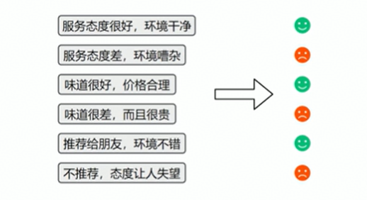

### 2.2 序列标注

- 对一段文本中的每个词或字打上标签
- 常见应用：命名实体识别（找出人名、地名、手机号码等）

### 2.3 文本生成

- 根据已有内容生成新的自然语言文本
- 常见引用：自动写作、摘要生成、智能回复、对话系统等

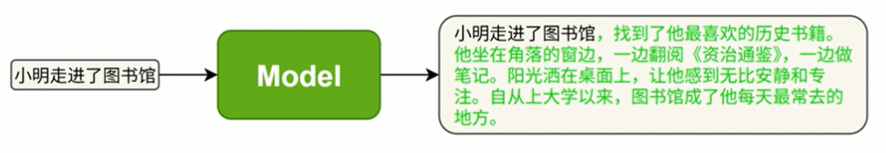

### 2.4 信息抽取

- 从文本中提取出结构化的信息
- 常见应用：给出一段文本和一个问题，从中抽取答案

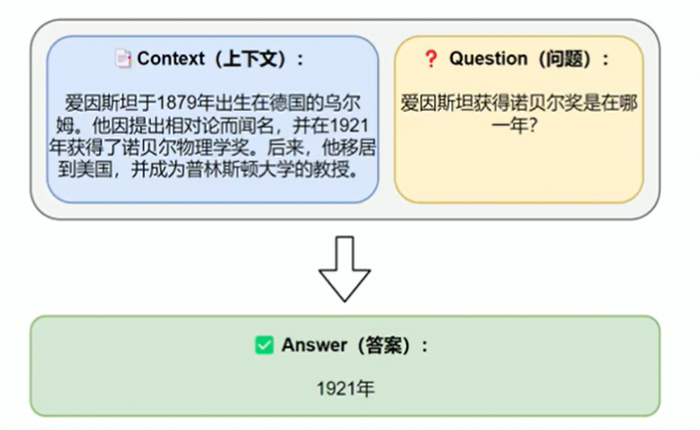

### 2.5 文本转换

- 将一种文本转换成另一种形式
- 常见应用：机器翻译、摘要生成等

## 3、技术演进历史

### 3.1 规则系统阶段

- 在20世纪50年代至80年代初，自然语言处理主要依赖**人工编写的语言规则**，这些规则由语言学家和程序员手动制定。这一阶段的代表系统有早期的机器翻译系统（如Georgetown-IBM实验）和ELIZA聊天机器人。这类系统在**特定领域表现良好，但缺乏通用性，扩展性差，对语言的复杂性处理有限**

- 举例

  - Georgetown-IBM实验：该实验演示了60多个俄语句子完全自动翻译成英语

  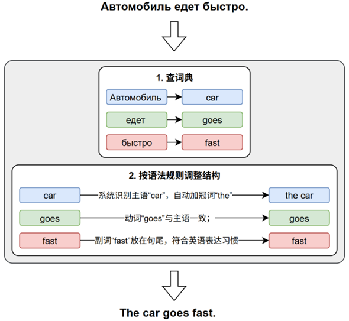

  - ELIZA聊天机器人：模拟人对话

  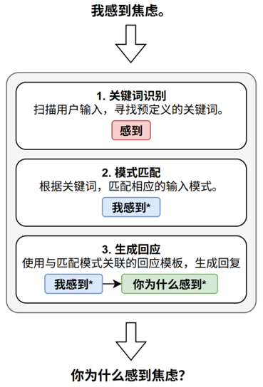

### 3.2 统计方法阶段

- 90年代，随着计算能力的提升和语料资源的积累，统计方法逐渐成为主流。通过对大量文本数据进行概率建模，系统能够“学习”语言中的模式和规律。典型方法包括n-gram模型、隐马尔可夫模型（HMM）和最大熵模型。这一阶段标志着从“专家经验”向“数据驱动”方法的转变。

- 举例

  - N-gram模型

    - N-gram 模型是一种基于统计的方法，用于**预测一个词在给定前几个词之后出现的可能性**。它是自然语言处理中最早出现的语言建模方法之一。

    - **该模型的核心思想是一个词出现的概率，只取决于它前面 N-1 个词**。例如，在一个 Bigram（2-gram）模型 中，我们假设每个词只与它前面的一个词有关；而在 Trigram（3-gram）模型 中，我们考虑前两个词。

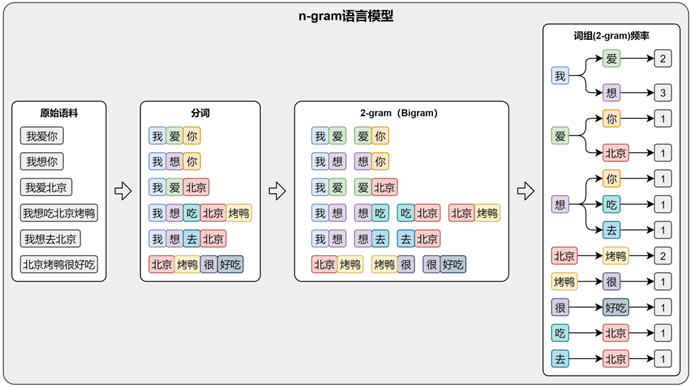

### 3.3 机器学习阶段

- 进入21世纪，NLP技术逐步引入传统机器学习方法，如逻辑回归、支持向量机（SVM）、决策树、条件随机场（CRF）等。这些方法在命名实体识别、文本分类等任务上表现出色。在此阶段，特征工程成为关键环节，研究者需要设计大量手工特征来提升模型性能。该阶段的特点是学习算法更为复杂，模型泛化能力增强。

- 基于词袋模型与逻辑回归的文本分类示例:

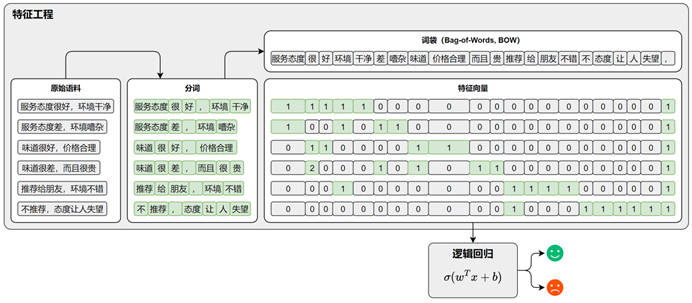

- 例子中提到的词袋模型，通过统计词频来表示文本，虽直接且简单，但它有一个明显的局限 —— 它完全忽略了词语的顺序。

  - 例如，如下两条完全相反的评论： 
    - ➤ 评论 A：“服务很好但味道差劲” 
    - ➤ 评论 B：“味道很好但服务差劲”

  - 分词后结果分别是： 
    - ➤ “服务很好但味道差劲” → [“服务”,“很”,“好”,“但”,“味道”,“差劲”] 
    - ➤ “味道很好但服务差劲” → [“味道”,“很”,“好”,“但”,“服务”,“差劲”]

  - 很明显，这两条评论在词袋模型中的特征向量是完全相同的。

  - 为了解决这个问题，“古人” 引入了 n-gram。n-gram 是将相邻的 n 个词作为一个整体来建模，这样就能保留一部分的词序信息。比如使用 trigram（3-gram），上述两条评论就会变为如下： 
    - ➤ [“服务很好”,“很好但”,“好但味道”,“但味道差劲”] 
    - ➤ [“味道很好”,“很好但”,“好但服务”,“但服务差劲”]

  - 其在词袋模型中的特征向量也就能够区分开了。

### 3.4 深度学习阶段

- 自2010年代中期开始，深度学习在NLP中迅速崛起。基于神经网络的模型RNN、LSTM、GRU等，取代了传统手工特征工程，能够从海量数据中自动提取语义表示。随后，Transformer架构的提出极大提升了语言理解与生成的能力，深度学习不仅在精度上实现突破，也推动了预训练语言模型（如GPT、BERT等）和迁移学习的发展，使NLP技术更通用、更强大
- RNN（Recurrent Neural Network）：

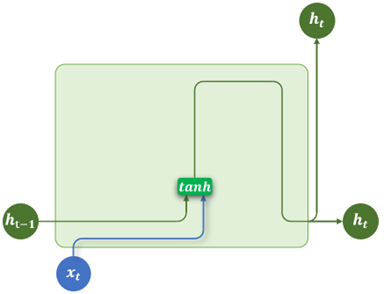

- LSTM（Long Short-Term Memory）：

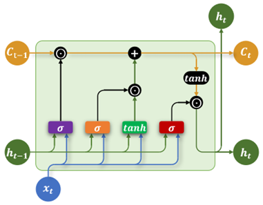

- GRU（Gated Recurrent Unit）：

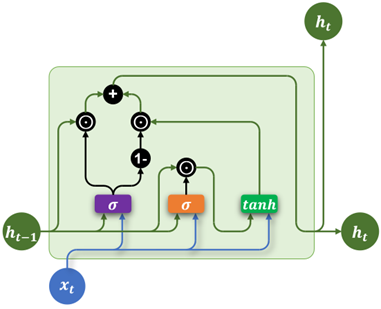

- Transformer：

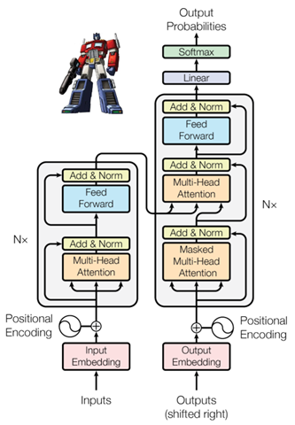

# 二、文本表示

## 1、概述

