# 一、导论

## 1、定义

- 自然语言处理：Natural Language Processing，简称NLP
- 是人工智能领域的一个重要分支
- 自然语言，指人类日常使用的语言（如：中文、英文），**NLP的目标识让计算机“理解”或”使用“这些语言**

## 2、常见任务

### 2.1 文本分类

- 对整段文本进行判断或归类
- 常见应用：情感分析（判断评价是正面还是负面）、垃圾邮件识别、新闻主题分类等

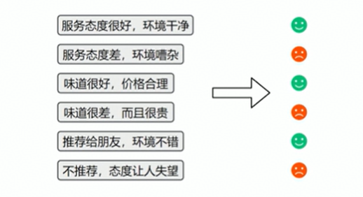

### 2.2 序列标注

- 对一段文本中的每个词或字打上标签
- 常见应用：命名实体识别（找出人名、地名、手机号码等）

### 2.3 文本生成

- 根据已有内容生成新的自然语言文本
- 常见引用：自动写作、摘要生成、智能回复、对话系统等

### 2.4 信息抽取

- 从文本中提取出结构化的信息
- 常见应用：给出一段文本和一个问题，从中抽取答案

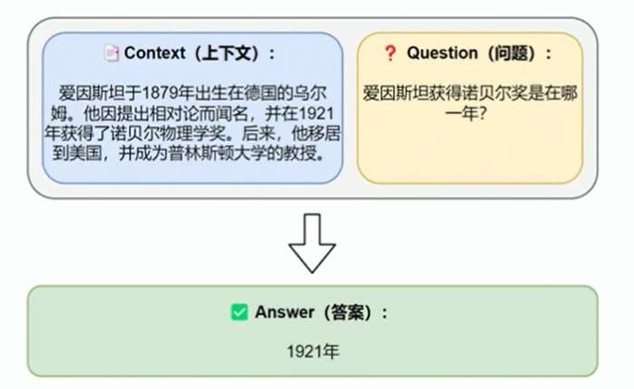

### 2.5 文本转换

- 将一种文本转换成另一种形式
- 常见应用：机器翻译、摘要生成等

## 3、技术演进历史

### 3.1 规则系统阶段

- 在20世纪50年代至80年代初，自然语言处理主要依赖**人工编写的语言规则**，这些规则由语言学家和程序员手动制定。这一阶段的代表系统有早期的机器翻译系统（如Georgetown-IBM实验）和ELIZA聊天机器人。这类系统在**特定领域表现良好，但缺乏通用性，扩展性差，对语言的复杂性处理有限**

- 举例

  - Georgetown-IBM实验：该实验演示了60多个俄语句子完全自动翻译成英语

  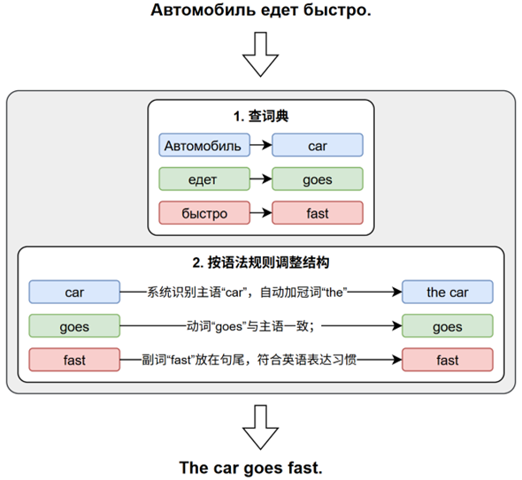

  - ELIZA聊天机器人：模拟人对话

  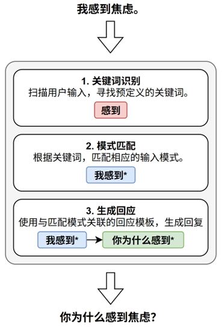

### 3.2 统计方法阶段

- 90年代，随着计算能力的提升和语料资源的积累，统计方法逐渐成为主流。通过对大量文本数据进行概率建模，系统能够“学习”语言中的模式和规律。典型方法包括n-gram模型、隐马尔可夫模型（HMM）和最大熵模型。这一阶段标志着从“专家经验”向“数据驱动”方法的转变。

- 举例

  - N-gram模型

    - N-gram 模型是一种基于统计的方法，用于**预测一个词在给定前几个词之后出现的可能性**。它是自然语言处理中最早出现的语言建模方法之一。

    - **该模型的核心思想是一个词出现的概率，只取决于它前面 N-1 个词**。例如，在一个 Bigram（2-gram）模型 中，我们假设每个词只与它前面的一个词有关；而在 Trigram（3-gram）模型 中，我们考虑前两个词。

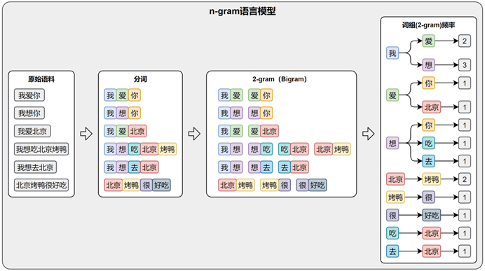

### 3.3 机器学习阶段

- 进入21世纪，NLP技术逐步引入传统机器学习方法，如逻辑回归、支持向量机（SVM）、决策树、条件随机场（CRF）等。这些方法在命名实体识别、文本分类等任务上表现出色。在此阶段，特征工程成为关键环节，研究者需要设计大量手工特征来提升模型性能。该阶段的特点是学习算法更为复杂，模型泛化能力增强。

- 基于词袋模型与逻辑回归的文本分类示例:

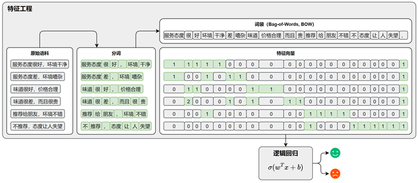

- 例子中提到的词袋模型，通过统计词频来表示文本，虽直接且简单，但它有一个明显的局限 —— 它完全忽略了词语的顺序。

  - 例如，如下两条完全相反的评论： 
    - ➤ 评论 A：“服务很好但味道差劲” 
    - ➤ 评论 B：“味道很好但服务差劲”

  - 分词后结果分别是： 
    - ➤ “服务很好但味道差劲” → [“服务”,“很”,“好”,“但”,“味道”,“差劲”] 
    - ➤ “味道很好但服务差劲” → [“味道”,“很”,“好”,“但”,“服务”,“差劲”]

  - 很明显，这两条评论在词袋模型中的特征向量是完全相同的。

  - 为了解决这个问题，“古人” 引入了 n-gram。n-gram 是将相邻的 n 个词作为一个整体来建模，这样就能保留一部分的词序信息。比如使用 trigram（3-gram），上述两条评论就会变为如下： 
    - ➤ [“服务很好”,“很好但”,“好但味道”,“但味道差劲”] 
    - ➤ [“味道很好”,“很好但”,“好但服务”,“但服务差劲”]

  - 其在词袋模型中的特征向量也就能够区分开了。

### 3.4 深度学习阶段

- 自2010年代中期开始，深度学习在NLP中迅速崛起。基于神经网络的模型RNN、LSTM、GRU等，取代了传统手工特征工程，能够从海量数据中自动提取语义表示。随后，Transformer架构的提出极大提升了语言理解与生成的能力，深度学习不仅在精度上实现突破，也推动了预训练语言模型（如GPT、BERT等）和迁移学习的发展，使NLP技术更通用、更强大
- RNN（Recurrent Neural Network）：

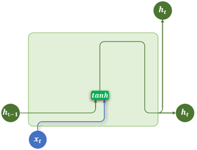

- LSTM（Long Short-Term Memory）：

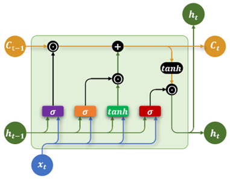

- GRU（Gated Recurrent Unit）：

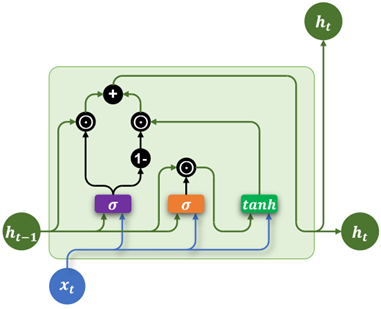

- Transformer：

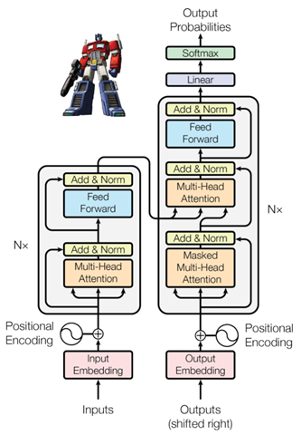

# 二、文本表示

## 1、概述

- 文本表示：**是将自然语言转化为计算机能够理解的数值形式**，是绝大多数自然语言处理（NLP）任务的基础步骤。
- 早期的文本表示方法（如词袋模型）通常将整段文本编码为一个向量。这类方法实现简单、计算高效，但存在明显的局限性—— **表达语序和上下文语义的能力较弱**。因此，现代NLP技术逐渐引入更加精细和表达力更强的文本表示方法，以更有效地建模语言的结构和含义。
- **文本表示的第一步通常是分词和词表构建**：

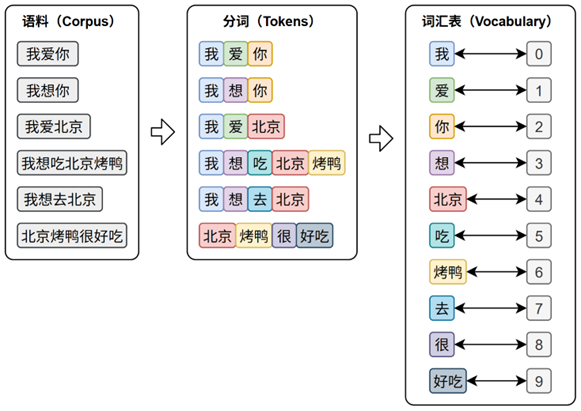

- 其中：

  - **分词（Tokenization）是将原始文本切分为若干具有独立语义的最小单元（即token）**的过程，是所有 NLP 任务的起点

  - **词表（Vocabulary）是由语料库构建出的、包含模型可识别 token 的集合**。词表中每个 token 都分配有唯一的ID，并支持 token 与 ID 之间的双向映射。

- 在后续训练或预测过程中，模型会首先对输入文本进行分词，再通过词表将每个 token 映射为其对应的 ID。接着，这些 ID 会被输入嵌入层（Embedding Layer），转换为低维稠密的向量表示（即词向量）

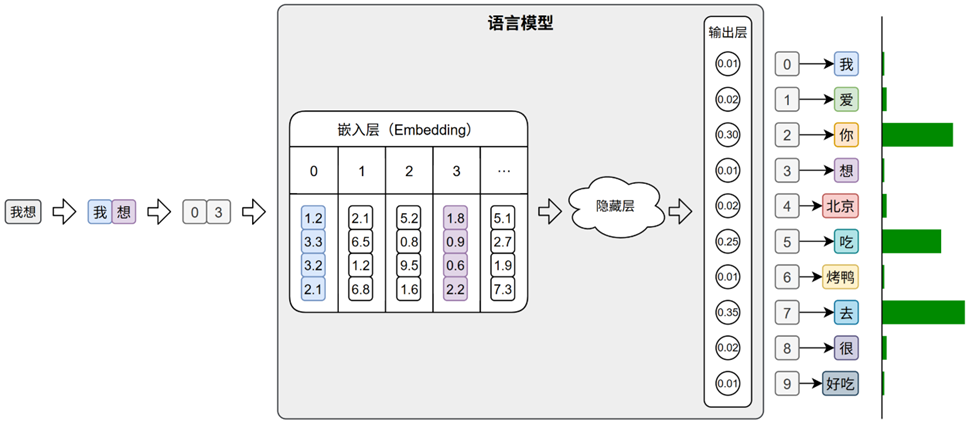

- 此外，在文本生成任务中，**模型的输出层会针对词表中的每个 token 生成一个概率分布**，表示其作为下一个词的可能性。系统通常选取具有最大概率的 ID，并通过词表查找对应的 token，从而逐步生成最终的输出文本

## 2、分词

- 不同语言由于语言结构、词边界的差异，其分词策略和算法也不尽相同

### 2.1 英文分词

- 按照分词粒度的大小，可分为
  - **词级（Word-Level）分词**
  - **字符级（Character-Level）分词**
  - **子词级（Subword-Level）分词**

#### 2.1.1 词级分词

- 词级分词：词级分词是指**将文本按照词语进行分词**，是最传统、最直观的分词方式。在英文中，空格和标点往往是天然的分隔符

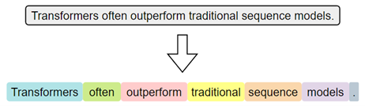

- 词级分词虽然便于理解和实现，但在实际应用中容易出现 OOV （Out-Of-Vocabulary，未登录词）问题。
- 所谓 OOV ，是指在模型使用阶段，**输入文本中出现了不在预先构建词表中的词语**，常见的包括网络热词、专有名词、复合词及拼写变体等。由于模型无法识别这些词，通常会将其统一替换为特殊标记（如<UNK> ），从而导致语义信息的丢失，影响模型的理解和预测能力

#### 2.1.2 字符级分词

- 字符级分词：**字符级分词是以单个字符为最小单位进行分词的方法**，文本中的每一个字母、数字、标点甚至空格，都会被视作一个独立的 token。

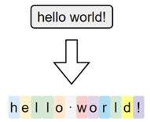

- 在这种分词方式下，词表仅由所有可能出现的字符组成，因此词表规模非常小，覆盖率极高，几乎不存在 OOV 问题。无论输入中出现什么样的新词或拼写变体，只要字符在词表中，都能被表示出来。

- 然而，由于**单个字符本身语义信息级弱**，模型必须依赖更长的上下文来推断词义和结构，这显著增加了建模难度和训练成本。此外，**输入序列也会变得更长，影响模型效率**

#### 2.1.3 子词级分词

- 子词级分词：子词级分词是一种介于词级分词和字符级分词之间的分词方法，**它将词语切分为更小的单元**——子词（subword），例如词根、前缀、后缀或常见词片段。与词级分词相比，子词分词可以显著缓解 OOV 问题；与字符级分词相比，它能更好地保留一定的语义结构。

- 子词分词的基本思想是：即使一个完整的词没有出现在词表中，只要它可以被拆分为词表中存在的子词单元，就可以被模型识别和表示，从而避免整体被替换为 <UNK>。
  - 比如：ChatGPT在词表中不存在，但是Chat，G、P、T在词表中有，那么拆分出来的子词就可以识别，而不是整体将ChatGPT替换为 <UNK>。

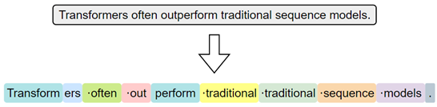

- 常见的子词分词算法包括 BPE（Byte Pair Encoding）、WordPiece 和 Unigram Language Model。

- 其中BPE 是最早被广泛应用的子词分词方法。其基本思想是：
  - 在训练阶段，**首先将语料中的词汇拆分为单个字符，构建初始词表；然后迭代地统计语料中出现频率最高的相邻字符对，将其合并为新的子词单元，并加入词表**。这个过程持续进行，直到词表大小达到预设上限。
  - 在分词阶段，BPE 会根据构建好的词表和合并规则对新输入的文本进行处理。具体做法是：**将文本拆分为最小单位（如字符或字节），然后按顺序应用训练中学习到的合并规则，逐步合并**，直到无法继续。最终得到的就是由子词组成的分词结果。

- 子词分词已经成为现代英文 NLP 模型中的主流方法，如 BERT、GPT 等模型均采用了基于子词的分词机制。
- BPE讲解示例：https://hf-mirror.com/learn/llm-course/zh-CN/chapter6/5

https://www.yuque.com/tmfl/ai/ozr8mm0dlw8nvpvp
