# 一、概述

## 1、人工智能分类

- 人工智能（Artificial Intelligence，AI）
  - **让机器表现出人的智能行为**
  - 旨在使机器能够执行诸如推理、学习、规划、决策和语言理解等任务
- 机器学习（Machine Learning，ML）
  - 人工智能的一个子领域
  - **让机器学习数据中的规律，并进行预测**
  - 强调通过数据训练模型，使其在没有明确编程规则的前提下，学会从数据中识别模式并做出预测或决策
- 深度学习（Deep Learning，DL）
  - 机器学习的子领域
  - **使用多层神经网络（深度神经网络）来从大量数据中提取特征和进行复杂任务处理**

## 2、深度学习简介

- 深度学习作为机器学习的一个分支，专注于使用多层神经网络（深度神经网络）来建模和解决问题

- 人脑中有很多相互连接的神经元，当大脑处理信息时，这些神经元之间通过电信号和化学物质相互作用，在大脑的不同区域之间传递信息。神经网络使用人工神经元模仿这种生物现象，这些人工神经元由称为节点的软件模块构成，使用数值计算来进行通信和传递信息

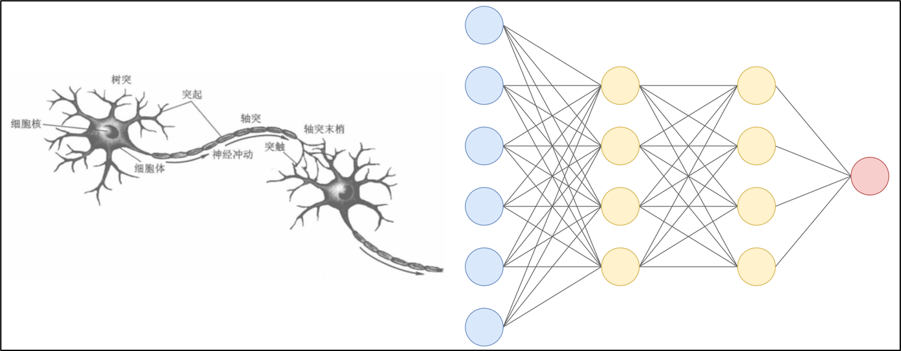

## 3、深度学习特点

- 使用多层神经网络，能够自动提取数据的多层次特征。不再需要像传统的机器学习那样人工构建特征工程
- 适合处理非结构化数据，如图像、音频、文本等
- 依赖大量数据和计算资源，训练时间较长
- 模型复杂，通常被视为“黑箱”，解释性较差

## 4、应用场景

- 金融服务：预测分析可推荐股票的算法交易，评估贷款审批的业务风险，检测欺诈行为，并帮助管理信贷和投资组合。
- 媒体和娱乐：从网上购物到流媒体服务，跟踪用户活动及开发个性化推荐也应用到了深度学习。
- 客户服务：聊天机器人、虚拟助手和拨入式客户服务门户网站利用语音识别等工具。 
- 医疗卫生：通过图像识别应用和深度学习技术，医学影像专家可以利用数字化的医疗记录和医学影像数据来支持和改进医学诊断过程，提供更精确和高效的医疗服务。 
- 工业自动化：在工厂和仓库中，深度学习应用可以自动检测人或物体何时处于机器的安全距离之外，或协助质量控制及预测性维护。 
- 自动驾驶汽车：汽车行业研究员使用深度学习来训练汽车检测停车标志、红绿灯、人行横道和行人等对象。 
- 航空航天和军事：深度学习技术可以用来在监控的大片地理区域中检测物体，从远处识别需要关注的区域，并为部队验证安全或不安全区域。 
- 执法：语音识别、计算机视觉和自然语言处理（NLP）有助于分析大量数据，从而节省时间和资源。

# 二、神经网络基础

## 1、神经网络构成

### 1.1 生物的神经

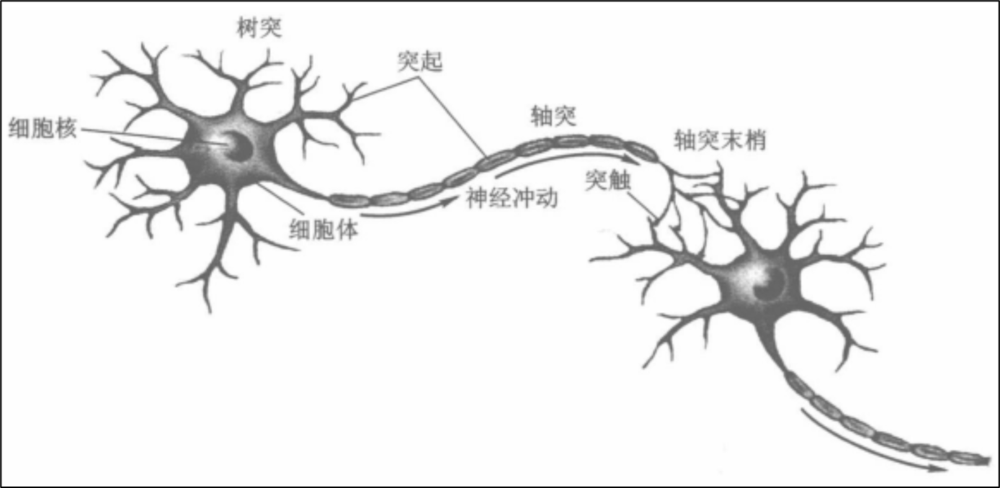

- 在生物体中，神经元是神经系统最基本的结构和功能单位。
- 神经元从树突接收其他神经元细胞发出的电化学刺激脉冲，这些脉冲叠加后，一旦强度达到临界值，这个神经元就会产生动作电位，沿着轴突发送电信号。
- 轴突将刺激传到末端的突触，电信号触发突触上面的电压敏感蛋白，把一个内含神经递质的小泡（突触小体）推到突触的膜上，从而释放出突触小体中的神经递质。这些化学物质会扩散到其他神经元的树突或轴突上。

### 1.2 基本概念和结构

- 人工神经网络（Artificial Neural Network，ANN）简称为**神经网络（NN）**，是一种模仿生物神经网络结构和功能的计算模型。大多数情况下人工神经网络能在外界信息的基础上改变内部结构，是一种自适应系统（adaptive system），通俗地说就是具备学习功能。

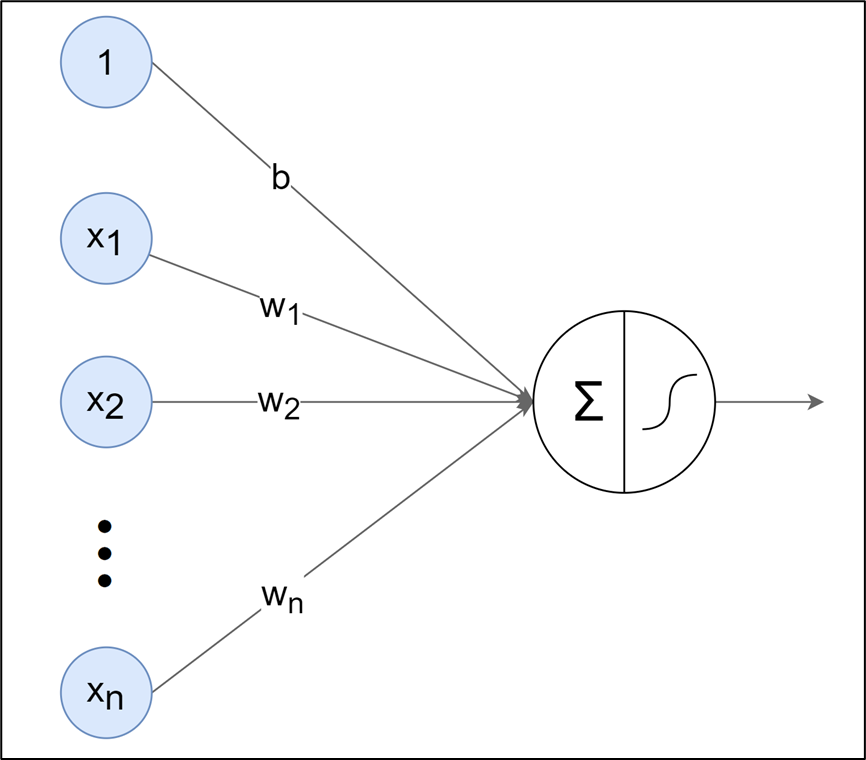

- 人工神经网络中的神经元，**一般可以对多个输入进行加权求和，再经过特定的”激活函数“转换后输出**

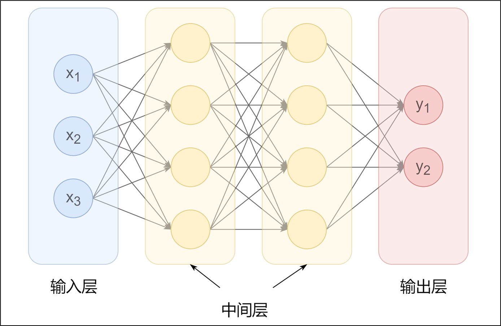

- 使用多个神经元就可以构建多层神经网络，最左边的一列神经元都表示输入，称为**输入层**；最右边一列表示网络的输出，称为**输出层**；输入层与输出层之间的层统称为**中间层（隐藏层）**。
- 相邻层的神经元相互连接（图中**下一层每个神经元都与上一层所有神经元连接，称为全连接**），每个连接都会有一个权重。
- 神经元中的信息逐层传递（一般称为 **前向传播**，forward），**上一层神经元的输出作为下一层神经元的输入**

### 1.3 感知机

- 感知机（Preceotron）是**二分类模型**，接收多个信号，输出一个信号。感知机的信号只有0、1两种取值

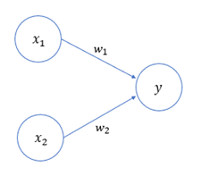

- x1、x2 是输入信号，y 是输出信号，w1、w2 是权重。〇称为神经元或节点。输入信号被送往神经元时，会分别乘以固定的权重。神经元会计算传送过来的信号的总和，**只有当这个总和超过某个界限时才会输出1**，也称之为神经元被激活。

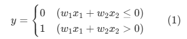

- 这里将接线的阈值设置为0。除了权重 w1、w2 之外，还可以增加一个参数b，被称为**偏置**

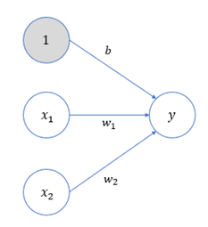

- 感知机的多个输入信号都有各自的权重，这些权重发挥着控制各个信号的重要性的作用，**权重越大，对应信号的重要性越高**。偏置则可以用来**控制神经元被激活的容易程度**

### 1.4 引入激活函数

- 在上面的式(1) 中，包含了两步处理操作：首先按照输入各自的权重及偏置，计算出一个加权总和；然后再根据这个总和与阈值的大小关系，决定输出0还是1
- 如果定义一个函数：

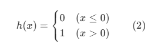

- 那么式(1) 就可以简化为：

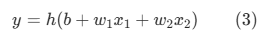

- 为了更明显地表示出两个处理步骤，可以进一步写成：

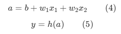

- 这里，我们将输入信号和偏置的加权总和，记作 a

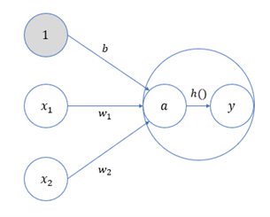

- h(x) 可以将输入信号的加权总和转换为输出信号，起到“激活神经元”的作用，所以被称为**激活函数**

- 说明

  - 单个感知机是线性的，如果没有激活函数，那么多个感知机、多层级加起来还是线性的。比如 **y = ax +b**、**z = cy + d**、那么 **z = acx + bc + d**，对于 z 来说，依然是 x 的线性函数。

  - 而引入了激活函数后，将输出进行了转换，就可以让多个感知机组合在一起时结果是非线性的

## 2、激活函数

### 2.1 作用

- 激活函数是**连接感知机和神经网络的桥梁**，在神经网络中起着至关重要的作用。

- 如果没有激活函数，整个神经网络就等效于单层线性变换，不论如何加深层数，总是存在与之等效的“无隐藏层的神经网络”。**激活函数必须是非线性函数**，也正是激活函数的存在为神经网络引入了非线性，使得神经网络能够学习和表示复杂的非线性关系

### 2.2 阶跃（Binary Step）函数

- 上面的感知机的式(2) 中，h(x)就是最简单的激活函数，它可以为输入设置一个“阈值”，一旦超过这个阈值，就切换输出（0或者1)。这种函数被称为“阶跃函数”。

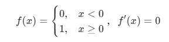

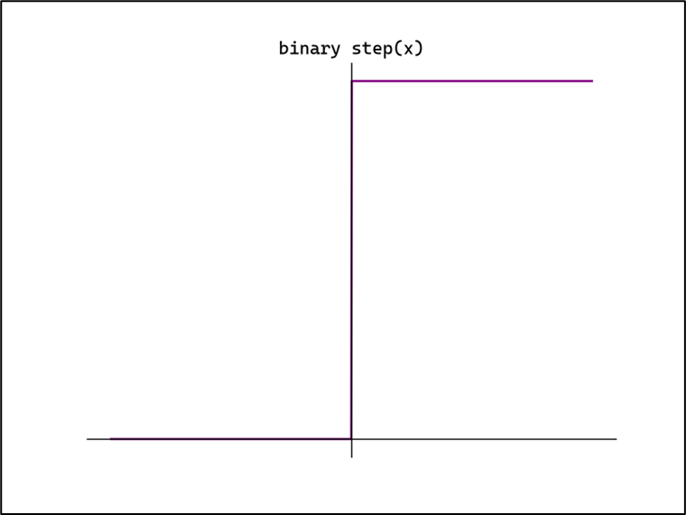

- 当x ≠ 0 时，阶跃函数的导数恒为0。
- 因为阶跃函数在数学上不可导，所以实际中不常用。
- 在Python中实现阶跃函数：

~~~python
import numpy as np

# 阶跃函数
# 传入的参数为一个标量
def step_function0(x):
    return 1 if x > 0 else 0

# 传入的参数为一个向量（一组特征）
def step_function(x):
    # 直接判断x>0，因为Python会自动将布尔转换为数字，True就是1，False就是0
    return np.array(x > 0, dtype=int)

# 测试验证
if __name__ == '__main__':
    x = np.array([0, 1, 2, 3, 4, 5, -1, -2, -3, -4, -5])
    print(step_function(x))
    
    
"""
[0 1 1 1 1 1 0 0 0 0 0]
"""
~~~

### 2.3 Sigmoid函数

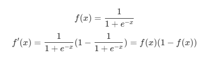

- Sigmoid（也叫Logistic函数）是平滑的、可微的，能将任意输入映射到区间 (0, 1)。**常用于二分类的输出层**。但因其涉及指数运算，计算量相对较高。

- Sigmoid的输入在 [-6, 6] 之外时，其输出值变化很小，可能导致信息丢失。

- Sigmoid函数的输出并非以0为中心，其输出值均 > 0 ，导致后续层的输入始终为正，可能影响后续梯度更新方向。

- **Sigmoid的导数范围为 (0, 0.25)，梯度较小。当输入在 [-6, 6] 之外时，倒数接近0，此时网络参数的更新将会极其缓慢**。使用 Sigmoid 作为激活函数，可能出现梯度消失（在逐层反向传播时，梯度会呈指数级衰减）。

- 在Python中实现Sigmoid函数：

~~~python
# Sigmoid函数
import numpy as np

# Sigmoid函数
def sigmoid(x):
    return 1 / (1 + np.exp(-x))

# 测试验证
if __name__ == '__main__':
    x = np.array([0, 1, 2, 3, 4, 5, -1, -2, -3, -4, -5])
    print(sigmoid(x))
    
    
"""
[0.5        0.73105858 0.88079708 0.95257413 0.98201379 0.99330715
 0.26894142 0.11920292 0.04742587 0.01798621 0.00669285]
 """
~~~

