# a、概述

## 1、人工智能分类

- 人工智能（Artificial Intelligence，AI）
  - <font color="red">**让机器表现出人的智能行为**</font>
  - 旨在使机器能够执行诸如推理、学习、规划、决策和语言理解等任务
- 机器学习（Machine Learning，ML）
  - 人工智能的一个子领域
  - <font color="red">**让机器学习数据中的规律，并进行预测**</font>
  - 强调通过数据训练模型，使其在没有明确编程规则的前提下，学会从数据中识别模式并做出预测或决策
- 深度学习（Deep Learning，DL）
  - 机器学习的子领域
  - <font color="red">**使用多层神经网络（深度神经网络）来从大量数据中提取特征和进行复杂任务处理**</font>


## 2、深度学习简介

- 深度学习作为机器学习的一个分支，专注于使用多层神经网络（深度神经网络）来建模和解决问题

- 人脑中有很多相互连接的神经元，当大脑处理信息时，这些神经元之间通过电信号和化学物质相互作用，在大脑的不同区域之间传递信息。神经网络使用人工神经元模仿这种生物现象，这些人工神经元由称为节点的软件模块构成，使用数值计算来进行通信和传递信息


## 3、深度学习特点

- 使用多层神经网络，能够自动提取数据的多层次特征。不再需要像传统的机器学习那样人工构建特征工程
- 适合处理非结构化数据，如图像、音频、文本等
- 依赖大量数据和计算资源，训练时间较长
- 模型复杂，通常被视为“黑箱”，解释性较差


## 4、应用场景

- 金融服务：预测分析可推荐股票的算法交易，评估贷款审批的业务风险，检测欺诈行为，并帮助管理信贷和投资组合。
- 媒体和娱乐：从网上购物到流媒体服务，跟踪用户活动及开发个性化推荐也应用到了深度学习。
- 客户服务：聊天机器人、虚拟助手和拨入式客户服务门户网站利用语音识别等工具。 
- 医疗卫生：通过图像识别应用和深度学习技术，医学影像专家可以利用数字化的医疗记录和医学影像数据来支持和改进医学诊断过程，提供更精确和高效的医疗服务。 
- 工业自动化：在工厂和仓库中，深度学习应用可以自动检测人或物体何时处于机器的安全距离之外，或协助质量控制及预测性维护。 
- 自动驾驶汽车：汽车行业研究员使用深度学习来训练汽车检测停车标志、红绿灯、人行横道和行人等对象。 
- 航空航天和军事：深度学习技术可以用来在监控的大片地理区域中检测物体，从远处识别需要关注的区域，并为部队验证安全或不安全区域。 
- 执法：语音识别、计算机视觉和自然语言处理（NLP）有助于分析大量数据，从而节省时间和资源。


# 二、神经网络基础

## 1、神经网络构成

### 1.1 生物的神经


- 在生物体中，神经元是神经系统最基本的结构和功能单位。
- 神经元从树突接收其他神经元细胞发出的电化学刺激脉冲，这些脉冲叠加后，一旦强度达到临界值，这个神经元就会产生动作电位，沿着轴突发送电信号。
- 轴突将刺激传到末端的突触，电信号触发突触上面的电压敏感蛋白，把一个内含神经递质的小泡（突触小体）推到突触的膜上，从而释放出突触小体中的神经递质。这些化学物质会扩散到其他神经元的树突或轴突上。


### 1.2 基本概念和结构

- 人工神经网络（Artificial Neural Network，ANN）简称为<font color="red">**神经网络（NN）**</font>，是一种模仿生物神经网络结构和功能的计算模型。大多数情况下人工神经网络能在外界信息的基础上改变内部结构，是一种自适应系统（adaptive system），通俗地说就是具备学习功能。


- 人工神经网络中的神经元，<font color="red">**一般可以对多个输入进行加权求和，再经过特定的”激活函数“转换后输出**</font>


- 使用多个神经元就可以构建多层神经网络，最左边的一列神经元都表示输入，称为<font color="red">**输入层**</font>；最右边一列表示网络的输出，称为<font color="red">**输出层**</font>；输入层与输出层之间的层统称为<font color="red">**中间层（隐藏层）**</font>。
- 相邻层的神经元相互连接（图中<font color="red">**下一层每个神经元都与上一层所有神经元连接，称为全连接**</font>），每个连接都会有一个权重。
- 神经元中的信息逐层传递（一般称为 <font color="red">**前向传播**</font>，forward），<font color="red">**上一层神经元的输出作为下一层神经元的输入**</font>


### 1.3 感知机

- 感知机（Preceotron）是<font color="red">**二分类模型**</font>，接收多个信号，输出一个信号。感知机的信号只有0、1两种取值


- x1、x2 是输入信号，y 是输出信号，w1、w2 是权重。〇称为神经元或节点。输入信号被送往神经元时，会分别乘以固定的权重。神经元会计算传送过来的信号的总和，<font color="red">**只有当这个总和超过某个界限时才会输出1**</font>，也称之为神经元被激活。


- 这里将接线的阈值设置为0。除了权重 w1、w2 之外，还可以增加一个参数b，被称为<font color="red">**偏置**</font>


- 感知机的多个输入信号都有各自的权重，这些权重发挥着控制各个信号的重要性的作用，<font color="red">**权重越大，对应信号的重要性越高**</font>。偏置则可以用来<font color="red">**控制神经元被激活的容易程度**</font>


### 1.4 引入激活函数

- 在上面的式(1) 中，包含了两步处理操作：首先按照输入各自的权重及偏置，计算出一个加权总和；然后再根据这个总和与阈值的大小关系，决定输出0还是1
- 如果定义一个函数：


- 那么式(1) 就可以简化为：


- 为了更明显地表示出两个处理步骤，可以进一步写成：


- 这里，我们将输入信号和偏置的加权总和，记作 a


- h(x) 可以将输入信号的加权总和转换为输出信号，起到“激活神经元”的作用，所以被称为<font color="red">**激活函数**</font>

- 说明

  - 单个感知机是线性的，如果没有激活函数，那么多个感知机、多层级加起来还是线性的。比如 **y = ax +b**、**z = cy + d**、那么 **z = acx + bc + d**，对于 z 来说，依然是 x 的线性函数。

  - 而引入了激活函数后，将输出进行了转换，就可以让多个感知机组合在一起时结果是非线性的


## 2、激活函数

### 2.1 作用

- 激活函数是<font color="red">**连接感知机和神经网络的桥梁**</font>，在神经网络中起着至关重要的作用。

- 如果没有激活函数，整个神经网络就等效于单层线性变换，不论如何加深层数，总是存在与之等效的“无隐藏层的神经网络”。<font color="red">**激活函数必须是非线性函数**</font>，也正是激活函数的存在为神经网络引入了非线性，使得神经网络能够学习和表示复杂的非线性关系


### 2.2 阶跃（Binary Step）函数

- 上面的感知机的式(2) 中，h(x)就是最简单的激活函数，它可以为输入设置一个“阈值”，一旦超过这个阈值，就切换输出（0或者1)。这种函数被称为“阶跃函数”。


- 当x ≠ 0 时，阶跃函数的导数恒为0。
- <font color="red">**因为阶跃函数在数学上不可导，所以实际中不常用**</font>
- 在Python中实现阶跃函数：

~~~python
import numpy as np

# 阶跃函数
# 传入的参数为一个标量
def step_function0(x):
    return 1 if x > 0 else 0

# 传入的参数为一个向量（一组特征）
def step_function(x):
    # 直接判断x>0，因为Python会自动将布尔转换为数字，True就是1，False就是0
    return np.array(x > 0, dtype=int)

# 测试验证
if __name__ == '__main__':
    x = np.array([0, 1, 2, 3, 4, 5, -1, -2, -3, -4, -5])
    print(step_function(x))
    
    
"""
[0 1 1 1 1 1 0 0 0 0 0]
"""
~~~


### 2.3 Sigmoid函数


- Sigmoid（也叫Logistic函数）是平滑的、可微的，能将任意输入映射到区间 (0, 1)。<font color="red">**常用于二分类的输出层**</font>。但因其涉及指数运算，计算量相对较高。

- Sigmoid的输入在 [-6, 6] 之外时，其输出值变化很小，可能导致信息丢失。

- Sigmoid函数的输出并非以0为中心，其输出值均 > 0 ，导致后续层的输入始终为正，可能影响后续梯度更新方向。

- Sigmoid的导数范围为 (0, 0.25)，梯度较小。当输入在 [-6, 6] 之外时，倒数接近0，此时网络参数的更新将会极其缓慢。<font color="red">**使用 Sigmoid 作为激活函数，可能出现梯度消失（在逐层反向传播时，梯度会呈指数级衰减）**</font>。

- 在Python中实现Sigmoid函数：

~~~python
# Sigmoid函数
import numpy as np

# Sigmoid函数
def sigmoid(x):
    return 1 / (1 + np.exp(-x))

# 测试验证
if __name__ == '__main__':
    x = np.array([0, 1, 2, 3, 4, 5, -1, -2, -3, -4, -5])
    print(sigmoid(x))
    
    
"""
[0.5        0.73105858 0.88079708 0.95257413 0.98201379 0.99330715
 0.26894142 0.11920292 0.04742587 0.01798621 0.00669285]
 """
~~~


### 2.4 Tanh函数

- 因为 Sigmoid 函数的值都大于0，x = 0时，sigmoid(x) = 0.5，所以如果想让 Sigmoid 函数有正有负且经过原点，可以直接让 y = Sigmoid(x) - 0.5。再进行一些转换，可以得出Tanh函数

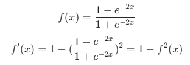

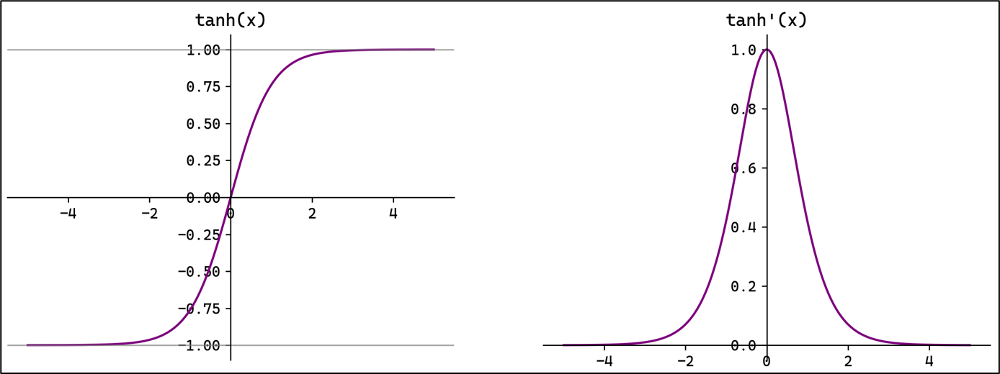

- <font color="red">**Tanh（双曲正切）**</font>将输入映射到区间 (-1, 1) 。<font color="red">**其关于原点中心对称。常用在隐藏层**</font>

- 输入在 [-3, 3] 之外时，Tanh的输出值变化很小，此时其导数接近0。

- Tanh的输出以0为中心，且其梯度相较于 Sigmoid 更大，收敛速度相对更快。但同样也存在梯度消失现象。

- Tanh函数与 Sigmoid 函数的关系：

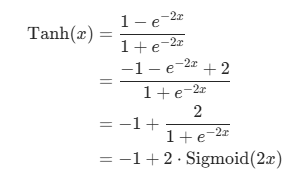

- 其中：

  - 原本 Sigmoid比原点高了0.5， 因为 Tanh 对 Sigmoid 函数放大了2倍，所以 Tanh 需要减1才能经过原点；

  - 因为自变量成了 2x ，所以原本Sigmoid函数在 [-6, 6] 之外变化很小，而 Tanh 在[-3, 3]之外就变化很小，梯度变化率变得更大。

- 在Python中，可以直接使用 Numpy 的双曲正切函数，无需自己实现：

~~~python
# Tanh函数
import numpy as np

# 测试验证
if __name__ == '__main__':
    x = np.array([0, 1, 2, 3, 4, 5, -1, -2, -3, -4, -5])
    print(np.tanh(x))
    
"""
[ 0.          0.76159416  0.96402758  0.99505475  0.9993293   0.9999092
 -0.76159416 -0.96402758 -0.99505475 -0.9993293  -0.9999092 ]
"""
~~~


### 2.5 ReLU函数

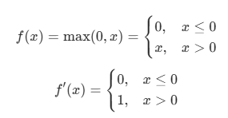

- 注意：x = 0 时 ReLU 函数不可导，此时我们默认使用左侧的函数，即规定 f '(x) = 0

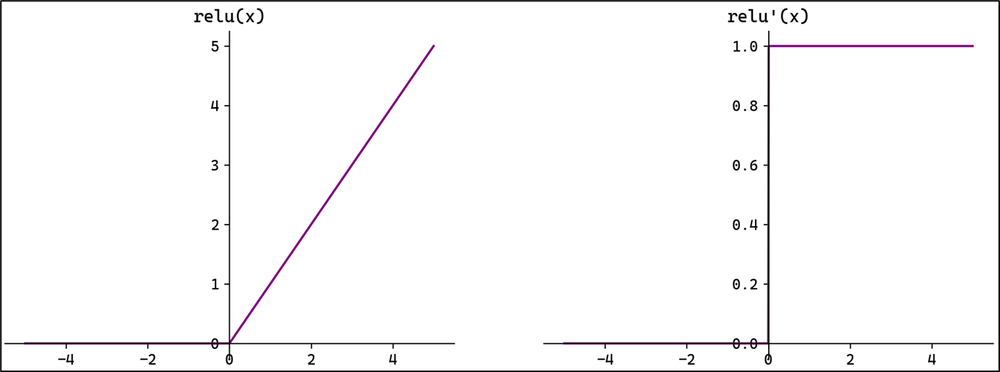

- ReLU（Rectified Linear Unit，修正线性单元）会将小于0 的输入转换为0，大于等于0的输入则保持不变。ReLU定义简单，计算量小。常用于隐藏层。

- <font color="red">**ReLU作为激活函数不存在梯度消失**</font>。当输入小于0时，ReLU的输出为0，这意味着在神经网络中，ReLU激活的节点只有部分是“活跃”的，这种稀疏性有助于减少计算量和提高模型的效率。

- <font color="red">**当神经元的输入持续为负数时，ReLU的输出始终为0。这意味着神经元可能永远不会被激活，从而导致“神经元死亡”问题**</font>。这会影响模型的学习能力，特别是如果大量的神经元都变成了“死神经元”。为解决此问题，可以使用 Leaky ReLU 来代替 ReLU作为激活函数。

- Leaky ReLU：a 是一个很小的常数

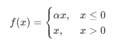

- Leaky ReLU在负数区引入一个小的斜率来解决“神经元死亡”问题。

- ReLU函数可以用代码实现如下：

```python
# ReLU函数
import numpy as np

# ReLU函数
def relu(x):
    return np.maximum(0, x)

# 测试验证
if __name__ == '__main__':
    x = np.array([0, 1, 2, 3, 4, 5, -1, -2, -3, -4, -5])
    print(relu(x))
```


### 2.6 Softmax函数

- Softmax函数：

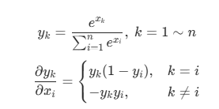


- <font color="red">**Softmax将一个任意的实数向量转换为一个概率分布，确保输出值的总和是1**</font>，是二分类激活函数Sigmoid在多分类上的推广。

- <font color="red">**Softmax常用于多分类问题的输出层**</font>，用来表示类别的预测概率。

- Softmax会放大输入中较大的值，使得最大输入值对应的输出概率较大，其他较小的值会被压缩。即在类别之间起到了一定的区分作用。

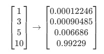

- Softmax函数可以用代码实现如下：

```python
# Softmax函数
# 对一条数据（即一个向量，一条数据多个特征）进行Softmax
def softmax0(x):
    return np.exp(x) / np.sum(np.exp(x))
```

- 如果输入是一个矩阵（多条数据），可以实现如下：

```python
# 输入数据为一个矩阵（多条数据，每条数据多个特征）进行Softmax
def softmax(x):
    # 如果是二维矩阵
    if x.ndim == 2:
        # axis=1按列求和
        y = np.exp(x) / np.sum(np.exp(x), axis=1)
        return y
    # 防止溢出的处理
    return np.exp(x) / np.sum(np.exp(x))
```

- 因为式子中存在次方，是一个指数函数，可能会因为值特别大导致计算时溢出。

- 为防止溢出，可以对上式进行改造：

- 先找到该行数据最大的一项 max(x) ，然后让函数式子的分子分母同时除以  次方（也即直接在指数上减去max(x))：

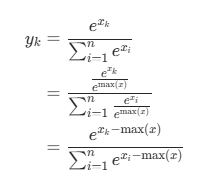

- 所以，可以将代码进行改造：

```python
# Softmax函数
import numpy as np

# 输入数据为一个矩阵（多条数据，每条数据多个特征）进行Softmax
def softmax(x):
    # 如果是二维矩阵
    if x.ndim == 2:
        # 防止溢出处理
        x = x.T # 将x进行行、列转置
        x = x - np.max(x, axis=0)  # 每一项都减去所在列数据最大的特征项（即减去转置前的每行最大值）
        y = np.exp(x) / np.sum(np.exp(x), axis=0) 
        return y.T # 将结果再转置回之前的行列格式输出
    # 防止溢出的处理
    x = x - np.max(x)
    return np.exp(x) / np.sum(np.exp(x))

# 测试验证
if __name__ == '__main__':
    X = np.array([[0, 1, 2], [3, 4, 5], [6, 7, 8], [-1, -2, -3]])
    print(softmax(X))
    
"""
[[0.09003057 0.24472847 0.66524096]
 [0.09003057 0.24472847 0.66524096]
 [0.09003057 0.24472847 0.66524096]
 [0.66524096 0.24472847 0.09003057]]
 """
```


### 2.7 其他常见激活函数

#### 2.7.1 Identity函数

- 恒等函数

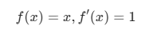

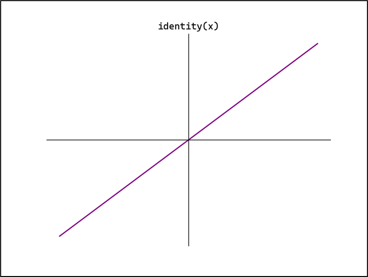

- 该函数还是线性的，而神经网络的中间层要求是引入非线性激活函数，所以一般不会在中间层引入Identity函数。但是可以在输出层使用
- 在Python中实现该函数：

~~~python
# Identity恒等函数
def identity(x):
    return x
~~~


#### 2.7.2 Leaky ReLU函数

- 在中间层如果使用 Sigmoid、Tanh 函数都可能出现梯度消失的情况，所以在中间层用的最多是 ReLU。
- 而在输出层，二分类可以用 Sigmoid，多分类可以用 Softmax函数，回归可以用 Identity恒等函数。
- 如果隐藏层的 ReLU不好用，可以进行一定的调整，例如 Leaky ReLU。
- Leaky ReLU算法：
  - 引入一个很小的斜率值 a ，这个 a 是一个指定的常数

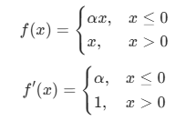

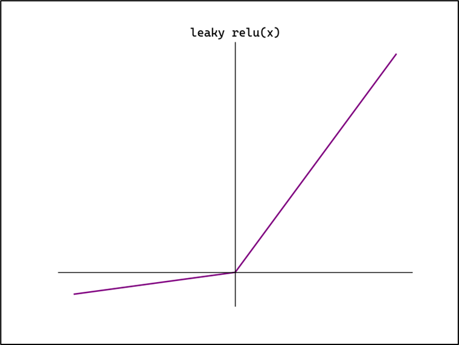


#### 2.7.3 PReLU函数

- PReLU 算法（参数化的 ReLU）：与 Leaky ReLU 算法类似，引入一个很小的斜率 a，但是这里的 a 是一个可训练的参数，而非固定的常数。

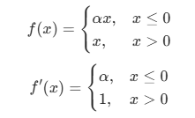

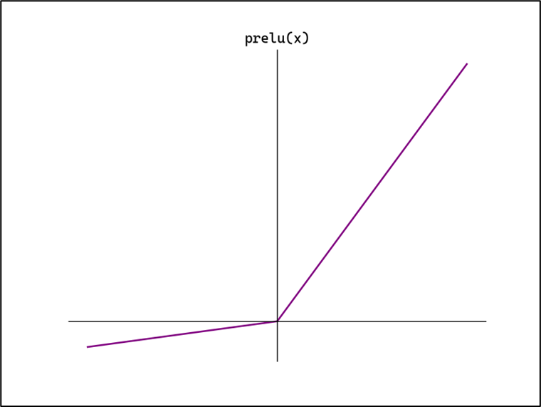


#### 2.7.4 RReLU函数

- RReLU（随机ReLU）：与 Leaky ReLU 算法类似，引入一个很小的斜率 a，这里的  是一个在训练时从一个均匀分布中随机选择的参数。

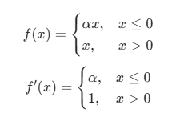

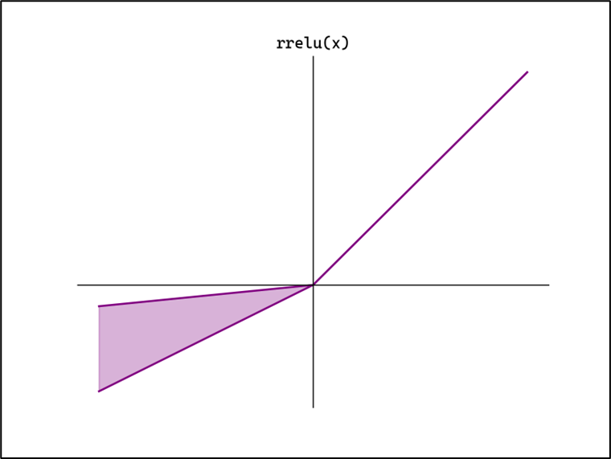


#### 2.7.5 ELU函数

- ELU（指数化的 ReLU）：在 x ≤ 0 时，设计成 a 乘以一个指数函数 。

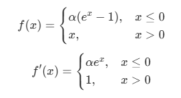

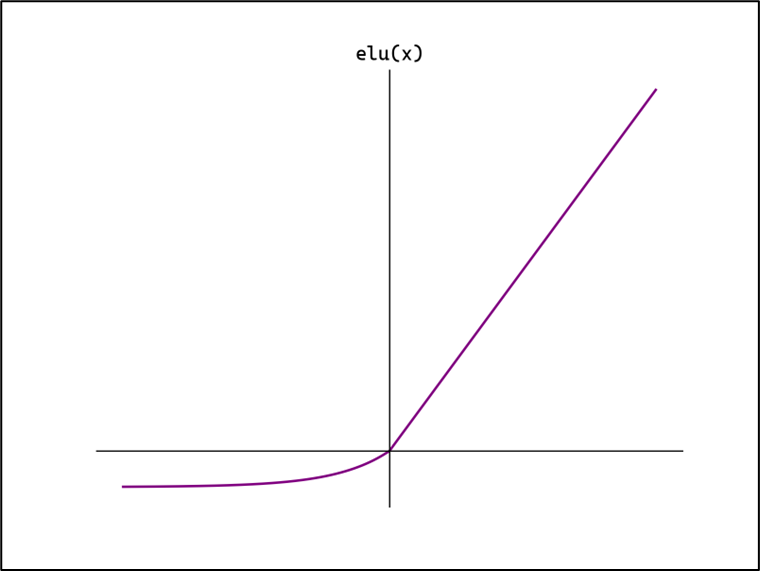


#### 2.7.6 Swish函数

- Swish、SiLU（把 Sigmoid 函数 和 ReLU 函数结合一起）：在 Sigmoid 函数上 乘以 x

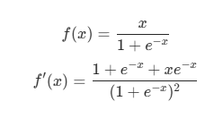

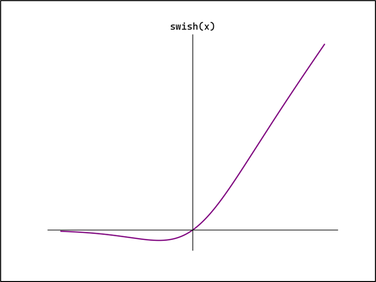


#### 2.7.7 Softplus函数

- Softplus：是 Sigmoid 函数的 积分函数（即 Softplus 函数的导数是Sigmoid函数）

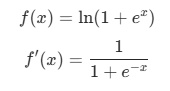

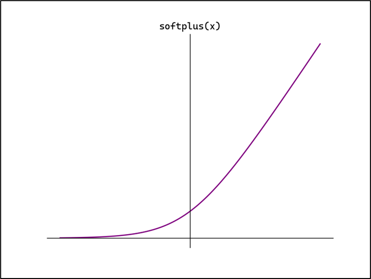


### 2.8 如何选择激活函数

- 隐藏层

  - 首选 ReLU ，如果效果不好可以尝试 Leaky ReLU 等

  - Sigmoid 在隐藏层易导致梯度消失，应尽量避免

  - Tanh 的输出均值为0，对中心化数据更友好，但仍可能引发梯度消失，仅适用于浅层网络，在深度神经网络中避免

- 输出层

  - 二分类选择 Sigmoid

  - 多分类选择 Softmax

  - 回归默认选择 Identify，或者直接输出


## 3、神经网络的简单实现

- 深度神经网络由多个层（layer）组成，通常将其称之为 <font color="red">**模型（Model）**</font>。
- 整个模型接收原始<font color="red">**输入（特征）**</font>，生成<font color="red">**输出（预测）**</font>，并包含一些<font color="red">**参数**</font>。
- 而在模型内部，每个单独的层都会接收一些输入（由前一层提供），生成输出（到下一层的输入），并包含一组参数；层层向下传递，就可以得到最终的输出值。
- <font color="red">**神经网络中的参数，就是每一层的权重和偏置**</font>


### 3.1 三层神经网络

- 以一个三层神经网络为例，实现从输入到输出的处理计算，这个过程就是 前向传播（forward）

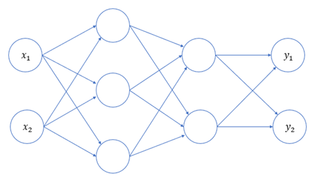

- 简单起见，我们的输入层（第0层）有2个神经元；第1个隐藏层（第1层）有3个神经元；第2个隐藏层（第2层）有2个神经元；输出层（第3层）有2个神经元


### 3.2 各层之间的信号传递

- 上面的图只是示意图，实际上每层还应该有偏置，各输入信号加权总和还要经过激活函数的处理


#### 3.2.1 输入层(第0层)->第1层

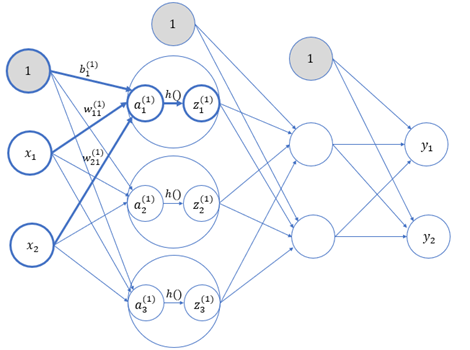

- 权重和神经元的上标（1）表示网络层号，而下标对于神经元来说，就是这一层内的“索引号”；

- 对于权重来说则包含两个数字，分别代表前一层和后一层神经元的索引号。所以，就表示这是第1层的权重（输入层到第1层），并且是从第2个输入节点到第1层第1个节点。

- 偏置的下标只有1个，因为前一层的偏置节点只有1个

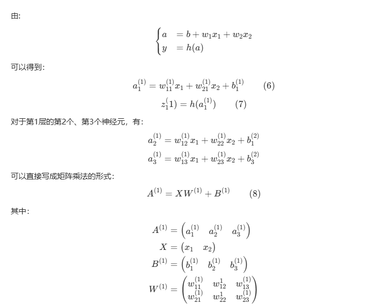

- 可以看到，由于有2个输入节点、3个第1层节点，所以全连接层的权重 就应该是一个  的矩阵。这样，我们就可以很容易地利用 Numpy中的矩阵乘法计算输出信号值了。


#### 3.2.2 第1层到第2层

- 第一层到第二层的处理相似，权重参数应该是一个3 x 2 的矩阵

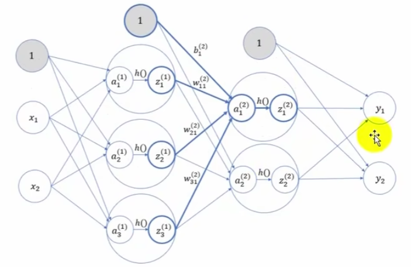


#### 3.2.2 第2层 -> 输出层（第3层）

- 第2层到输出层的处理也类似，权重参数为  的矩阵；不过输出层的激活函数一般与隐藏层是不同的，这里用  表示。

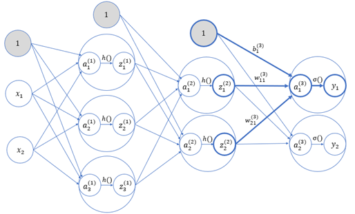


## 4、代码实现

- 我们可以将神经网络的所有参数（每一层的权重 和偏置 ），保存在一个字典 network 中；并定义函数：

- init_network()：对参数进行初始化，每一个权重参数都是一个矩阵（二维），每一个偏置参数都是一个数组（一维）。（实际中，神经网络的参数是需要通过训练学习得到的，这里我们假设已经训练完毕，得到了这一组参数）

- forward()：前向传播，将输入信号转换为输出信号的处理操作

- 这里的激活函数，隐藏层用 Sigmoid，输出层用 Identity恒等函数。

~~~python
# 简单的神经网络实现
import numpy as np

# Sigmoid函数
def sigmoid(x):
    return 1 / (1 + np.exp(-x))

# Identity恒等函数
def identity(x):
    return x

# 初始化神经网络（定义神经网络的参数，假设已经训练完得到的模型参数）
def init_network():
    network = {}
    # 第一层参数（输入层到第1个隐藏层）
    # 输入层2个神经元，第1个隐藏层3个神经元，所以：W1是 2x3 的矩阵，b1 有3个元素
    network['W1'] = np.array([[0.1, 0.3, 0.5], [0.2, 0.4, 0.6]])
    network['b1'] = np.array([0.1, 0.2, 0.3])
    # 第二层参数（第1个隐藏层到第2个隐藏层）
    # 第1个隐藏层有3个神经元，第2个隐藏层有2个神经元，所以：W2是 3x2 的矩阵，b2 有2个元素
    network['W2'] = np.array([[0.1, 0.4], [0.2, 0.5], [0.3, 0.6]])
    network['b2'] = np.array([0.1, 0.2])
    # 第三层参数（第2个隐藏层到输出层）
    # 第2个隐藏层有2个神经元，输出层有2个神经元，所以：W3是 2x2 矩阵，b3有2个元素
    network['W3'] = np.array([[0.1, 0.3], [0.2, 0.4]])
    network['b3'] = np.array([0.1, 0.2])
    return network

# 前向传播
# 隐藏层使用Sigmoid函数作为激活函数
# 输出层使用Identity函数作为激活函数
def forward(network, x):
    # 获取参数
    w1, w2, w3 = network['W1'], network['W2'], network['W3']
    b1, b2, b3 = network['b1'], network['b2'], network['b3']
    # 逐层进行计算传递
    a1 = np.dot(x, w1) + b1
    z1 = sigmoid(a1)  # 得到 输入 -> 第1个隐藏层计算结果
    a2 = np.dot(z1, w2) + b2
    z2 = sigmoid(a2) # 得到 第1个隐藏层 -> 第2个隐藏层计算结果
    a3 = np.dot(z2, w3) + b3
    y = identity(a3) # 得到 第2个隐藏层 -> 输出层计算结果
    return y

# 测试主流程
network = init_network()

# 定义数据
# x = np.array([1.0, 0.5]) # 传入一行数据进行预测，数据2个特征：x1、x2
x = np.array([[1.0, 0.5],[1.5,0.2],[2.1,0.4]]) # 传入3行数据进行预测，数据2个特征：x1、x2

# 前向传播（预测）
y = forward(network, x)
print(y)
~~~


## 5、手写数字识别

我们使用Kaggle上的Digit Recognizer数据集来进行手写数字识别。

文件train.csv中包含手绘数字（从0到9）的灰度图像，每张图像为28×28像素，共784像素。每个像素有一个0到255的值表示该像素的亮度。

文件第1列为标签，之后784列分别为784个像素的亮度值。

搭建一个神经网络，实现它的前向传播；也就是要根据输入的数据（28×28 = 784数据点表示的图像），推断出它到底是哪个数字，这个过程也被称为“推理“。

这里，我们构建的也是一个三层神经网络，输入层应该有784个神经元，输出层有10个神经元（表示0~9的分类结果）；中间设置2个隐藏层，第一个隐藏层有50个神经元，第二个隐藏层有100个神经元。

这里的参数是需要学习得到的，我们假设已经学习完毕，直接从保存好的文件 `nn_sample` 中进行读取即可。


三、
