# 一、数学知识

## 1、高数

### 1.1 导数

#### 1.1.1 概念

- 导数（derivative）是微积分中的一个概念。函数在某一点的导数是指**这个函数在这一点附近的变化率（即函数在这一点的切线斜率）**。导数的本质是通过极限的概念对函数进行局部的线性逼近

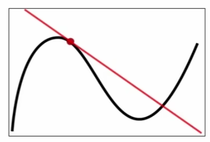

- 当函数 f 的自变量在一点 x₀上产生一个增量 h 时，函数输出值的增量 ∆y 与自变量增量 ∆x 的比值在 ∆x 趋于 0 时的极限如果存在，即为 f 在 x₀ 的导数

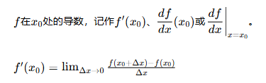

- 导数有很多应用，例如在运动学中，物体的位移对于时间的导数就是物体的瞬时速度：v=∆y/∆x

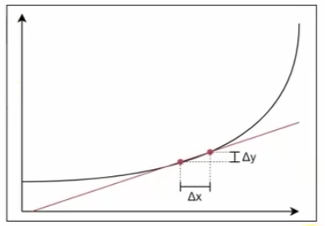

#### 1.1.2 基本函数的求导

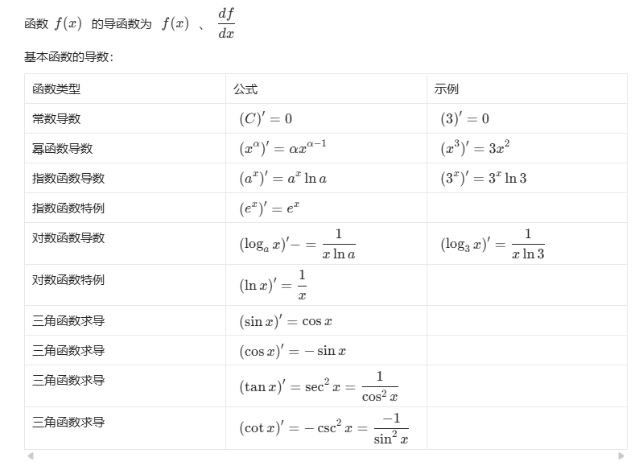

#### 1.1.3 求导法则

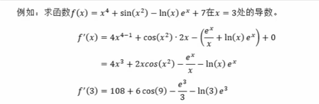

#### 1.1.4 利用导数求极值

- 导数等于零的点称为函数的驻点（或极值可疑点），在这类点上函数可能会取得极大值或极小值。进一步判断则需要知道导数在附近的符号

- **驻点不一定是极值点**

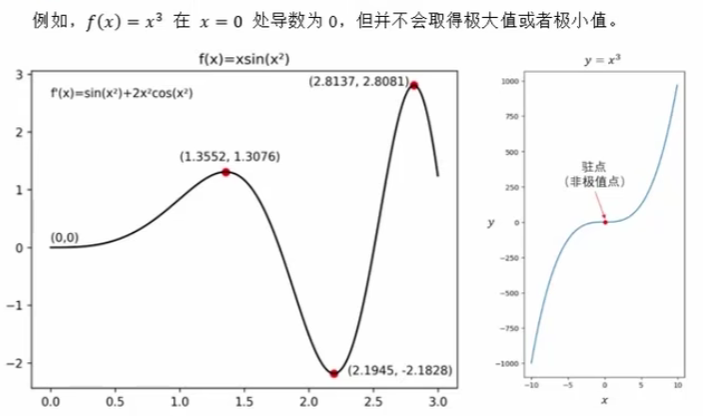

#### 1.1.5 二阶导数

- 二阶导数概念

  - 在微积分中，函数的二阶导数是函数导数的导数。粗略来说，**某个量的二阶导数描述该量变化率变化的快慢**。例如物体位置对时间的二阶导数是物体的瞬时加速度，即该物体速度随时间的变化率：

  

- 二阶导数与函数凹凸的关系

  - 数的二阶导数描述了函数图像的凹凸方向和程度。

    - 若二阶导数在某区间恒为正，代表 f'(x) 在持续变大，切线就越来越陡，显示向上弯，则函数在该区间向上弯（也称**下凸函数**）。
    - 反之，若二阶导数在某区间恒为负，代表 f'(x) 在持续变小，切线就越来平缓，显示向下弯，则函数在该区间向下弯（也称**上凸函数**）。

    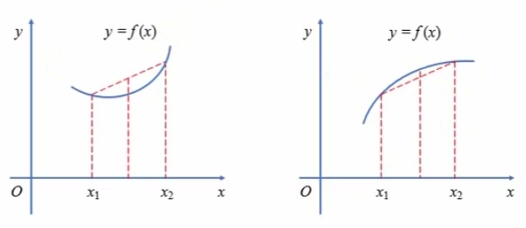

  - 对于下凸函数，有：

  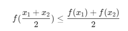

  - 对于上凸函数，有：

  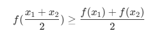

  - 若函数的二阶导数在某点左右异号，则图像由向上弯转为向下弯，或反之。这种点称之为**拐点**。若二阶导数连续，则在该点处二阶导数为 0。但反之二阶导数为 0 的点不一定是拐点。如 f(x)=x⁴，在 x=0 处有 f''(0)=0，但 f(x) 在实数系上无拐点

  

  - 二阶导数与凹凸性关系可以判断函数的驻点是否为极大值点或极小值点：

    - 若 f'(x) = 0，f''(x) < 0，则 f 在 x 处取得极大值

    - 若f'(x) = 0，f''(x) > 0，则 f 在x处取得极小值

    - 若f'(x) = 0，f''(x) = 0，则该点可能是拐点，也可能是极大值点或极小值点

  - 二阶导数的应用图像

    - 黑点位置，正弦函数的 f'(x)=0，f''(x) < 0 ，在黑点处取得了极大值
    - 蓝点位置，正弦函数的 f'(x)=0，f''(x) > 0 ，在蓝点处取得了极小值
    - 紫点位置，正弦函数的 f''(x)=0 ，在紫点处为拐点

    ~~~python
    import numpy as np
    import matplotlib.pyplot as plt
    
    # 定义函数sin(x)
    x = np.arange(0, 6, 0.1)
    y1 = np.sin(x)
    # 一阶导数cos(x)
    y2 = np.cos(x)
    
    # 画出图像
    plt.plot(x, y1, label="sin(x)")
    plt.plot(x, y2, label="cos(x)", linestyle="--")
    plt.xlabel('x')
    plt.ylabel('y')
    plt.title('sin(x)')
    plt.show()
    ~~~

  

### 1.2 偏导数与梯度

#### 1.2.1 偏导数

- 如果函数 f 的自变量并非单个元素，而是多个元素，例如：f(x, y) = x² + xy + y²

- 可将其中一个元素 x 看做常数，此时 f 可以看做关于另一个元素 y 的函数：

  

- 在x = a 固定的情况下，可以计算 f 关于 y 的导数：f'(x, y) = a + 2y

- 这种导数称为偏导数，一般记作：

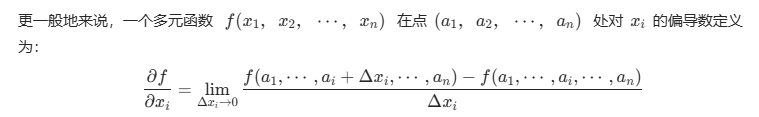

- 当把 x 看做常数，求函数的偏函数时，本质就是：在 x = a这条线，将原本的图像切出来一个横截线，这个切出来的曲线就是 f(x, y)关于 y 的函数，这个偏导数就是这个曲线的导数。

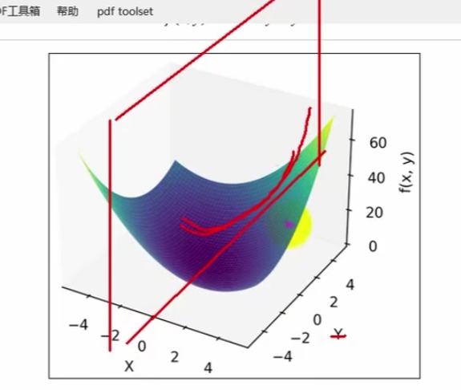

####  1.2.2 方向导数

- 对于二元函数 z=f(x,y)，在点 P(x₀, y₀)，沿着**单位方向向量 l = (cosα, cosβ)**的方向导数：

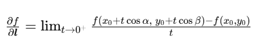

# 二、机器学习概述

## 1、人工智能、机器学习、深度学习

### 1.1 三者概念

- 什么是人工智能（Artificial Intelligence）：AI

  - 人工智能是研究智能行为的计算代理的合成和分析的领域
  - 人工智能就是用计算机来模拟人脑
  - 简单来说：**用计算机来模拟人脑，让计算机能够像人类一样 ，理性的思考和行动**

- 什么是机器学习（Machine Learning）：ML

  - 赋予计算机学习能力而不需要明确编程的研究领域
  - 简单来说：**不需要之前那种明确的if else这种具体的代码，而是让计算机能够自己学习知识，然后对新数据进行预测处理**
  - 机器如何学习：先训练，再预测

  

- 什么是深度学习（Deep Learning）：DL

  - 也叫深度神经网络，大脑仿生，设计一层一层的神经元模拟完事万物
  - 简单来说：**让机器像人脑一样，通过多层神经网络，自动从大量数据里学习规律，从而自己做判断、识别、生成内容**

  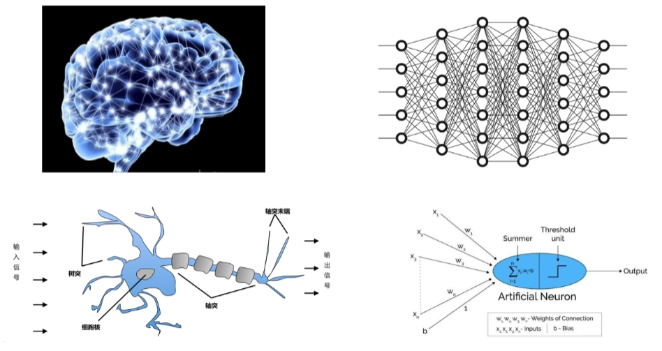

### 1.2 三者关系

- 机器学习是实现人工智能的一种途径
- 深度学习是机器学习的一种方法

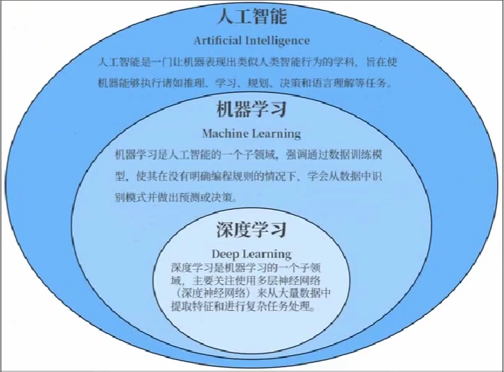

### 1.3 机器学习和深度学习的区别

- 机器学习（传统）

  - **需要人工提取特征**，比如识别猫：人要告诉机器 “耳朵、胡须、爪子” 这些特征

  - 模型层数少，结构简单

  - 数据量小也能用

  - 可解释性强，人能看懂它怎么判断的

- 深度学习

  - **不需要人工提取特征**
  - 直接喂图片，模型自己一层层学特征

  - 层数很多（深度网络）

  - 需要**大量数据 + 强大算力（GPU）**

  - 效果更强，但像黑盒，不太好解释

- 用一个例子对比：识别猫

  - 传统机器学习

    - 人手动设计特征：颜色、边缘、纹理、形状

    - 把特征输入模型（SVM、决策树等）

    - 模型学习分类

  - 深度学习

    - 直接把像素丢进神经网络

    - 第一层学边缘

    - 第二层学形状

    - 高层学 “猫” 整体

    - 自动判断是不是猫

- 一句话：**深度学习自动干了人原本要做的特征工作**

### 1.4 学习方式

- 基于规则的学习：程序员根据经验利用**手工的if-else方式进行预测**

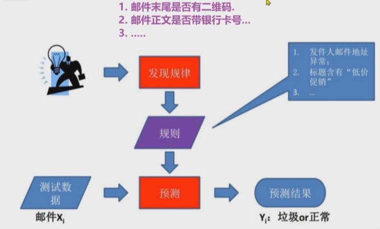

- 基于模型的学习：**从数据中自动学出规律**

  - 有很多问题无法明确的写下规则，此时无法使用规则学习的方式来解决这类问题，比如：图像和语音识别和自然语言处理

  

## 2、机器学习定义

- 机器学习（Maching Learning，ML）主要研究计算机系统对于特定任务的性能，逐步进行改善的算法和统计模型。

- **通过输入海量训练数据进行训练，使模型掌握数据所蕴含的潜在规律，进而对新输入的数据进行准确的分类或预测。**

- 机器学习是一门多领域交叉学科，涉及概率论、统计学、逼近论、凸优化、算法复杂度理论等多门学科。

## 3、机器学习的应用领域和发展史

- 应用领域
  - **计算机视觉 CV**：对人看到的东西进行理解
  - **自然语言处理**：对人交流的东西进行理解
  - **数据挖掘和数据分析**：也属于人工智能的范畴

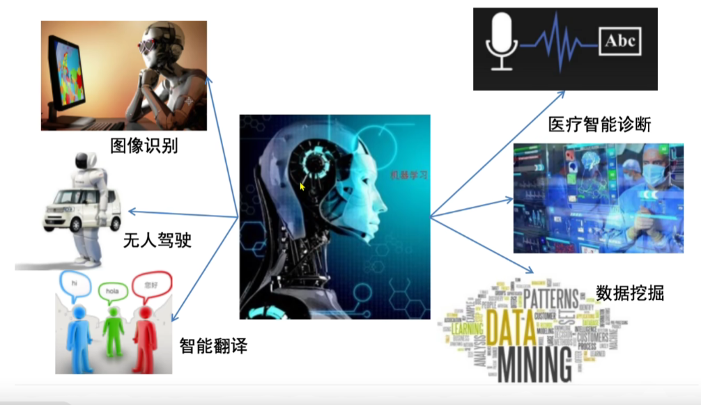

- 发展史
  - 1956 年人工智能元年
  - 2012 年计算机视觉深度神经网络方法研究兴起
  - 2017 年自然语言处理应用大幕拉开
  - 2022 年 chatGPT 的出现，引起 AIGC 的发展

## 4、基本术语

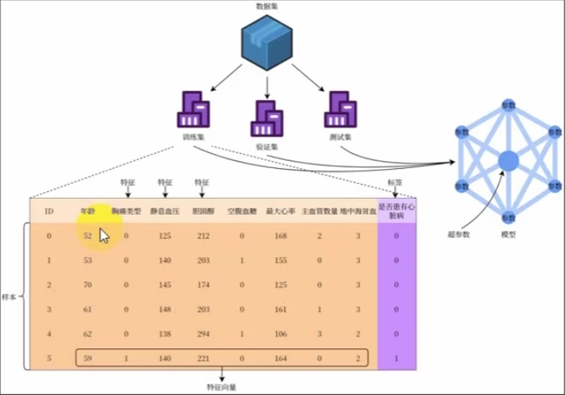

- 数据集（Data Set）：多条记录的集合。

  - 训练集（Training Set）：用于训练模型的数据

  - 验证集（Validation Set）：用于调节超参数的数据

  - 测试集（Test Set）：用于评估模型性能的数据

- 样本（Sample）：数据集中的一条记录是关于一个事件或对象的描述，称为一个样本。
- 特征（Feature）：数据集中一列反映事件或对象在某方面的表现或性质的事项，称为特征或属性。
- 特征向量（Feature Vector）：将样本的所有特征表示为向量的形式，输入到模型中。
- 标签（Label）：监督学习中每个样本的结果信息，也称作目标值（target）。
- 模型（Model）：一个机器学习算法与训练后的参数集合，用于进行预测或分类。
- 参数（Parameter）：模型通过训练学习到的值，例如线性回归中的权重和偏置。
- 超参数（Hyper Parameter）：由用户设置的参数，不能通过训练自动学习，例如学习率、正则化系数等。

# 三、机器学习基本理论

## 1、机器学习三要素

- 机器学习的方法一般主要由三部分构成：模型、策略和算法，可以认为：机器学习方法 = 模型 + 策略 + 算法

  - 模型（Model）：总结数据的内在规律，用数学语言描述的参数系统

  - 策略（Strategy）：选取最优模型的评价准则

  - 算法（Algorithm）：选取最优模型的具体方法

## 2、机器学习方法分类

从不同的角度，可以将机器学习的方法进行不同的分类：

- 通常分类：按照有无监督，将机器学习分为：有监督学习、无监督学习和半监督学习。除此之外，还有强化学习

- 按模型分类：根据模型性质，可以分为概率模型/非概率模型，线性/非线性模型等。

- 按学习技巧分类：根据算法基于的技巧，可以分为贝叶斯学习、核方法等。

### 2.1 监督学习和无监督学习

- 监督分类

  - **监督学习**：**有特征有标签**
    - 定义：输入数据是由输入特征值和目标值所组成，即**输入的训练数据有标签**
    - 数据集：需要标注数据的标签/目标值

  - **无监督学习**：**有特征无标签**
    - 定义：输入数据没有被标记，即样本数据类别未知，**没有标签**，根据样本间的相似性，对样本集聚类，以发现事物内部的结构和相似性
    - 数据集：标注数据没有标签/目标值
  - 如下：
    - 左侧的是监督学习，有特征有标签，电影名称、搞笑镜头、拥抱镜头、打斗镜头等为特征，电影类型为标签
    - 右侧的是无监督学习，有特征无标签，根据样本间的相似性，对样本集聚类，比如：有无帽子分一类、手里有无工具分一类等，然后根据这些发现其结构和相似性，从而发现标签/目标值

- 监督学习下分类
  - **分类问题**
    - 目标值（标签值）是不连续的
    - 分类种类：二分类、多分类
  - **回归问题**
    - 目标值（标签值）是连续的
  - 如下：
    - 左侧的是分类问题，标签值是分具体类别的
    - 右侧的是回归问题，标签值是那种连续的

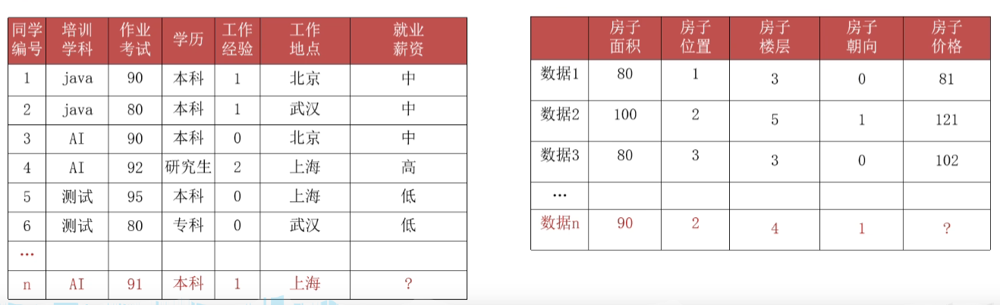

- 无监督学习下分类
  - **聚类问题**
    - 无监督学习是有特征无标签的类型，所以只能依靠样本间相似性对数据进行聚类，然后发现其内部结构和相互关系

### 2.2 半监督学习

- **有特征，部分数据有目标值（标签值）**

- 工作原理
  - 让专家标注少量数据，利用已经标记的数据（也就是带有类标签）训练出一个模型
  - 再利用该模型去套用未标记的数据
  - 通过询问领域专家分类结果与模型分类结果做对比，从而对模型做进一步改善和提高
- **半监督学习可以大幅度降低标记成本**

- 例子

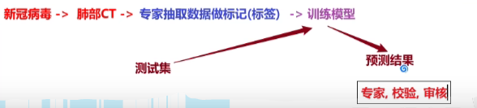

### 2.3 强化学习

- **强化学习（Reinforcement Learning）**：机器学习的一个重要分支
- **应用场景**：里程碑 AlphaGo 围棋、各类游戏、对抗比赛、无人驾驶场景

- 四要素
  - Agent
  - 环境
  - 奖励
  - 动作
- 基本原理：Agent根据环境状态进行行动获取最多的累计奖励
- 总结：**强化学习 = 寻找最短路径 (最优解)，以便获取最多的奖励**

### 2.4 总结

| 学习类型                                 | 核心特点 | 输入数据                        | 输出 / 反馈     | 核心目标                   | 典型案例                                 |
| ---------------------------------------- | -------- | ------------------------------- | --------------- | -------------------------- | ---------------------------------------- |
| **监督学习**(Supervised Learning)        | 有老师教 | 带标签的数据（输入 + 正确答案） | 有明确反馈      | 预测结果 / 分类            | 猫狗图像分类、房价预测、垃圾邮件识别     |
| **无监督学习**(Unsupervised Learning)    | 自主探索 | 无标签数据（只有输入）          | 无反馈          | 发现数据内在结构 / 规律    | 客户分群、异常检测、“物以类聚，人以群分” |
| **半监督学习**(Semi-Supervised Learning) | 折中方案 | 少量有标签 + 大量无标签数据     | 有反馈          | 降低标注成本，提升模型效果 | 文本分类、图像识别（标注成本高的场景）   |
| **强化学习**(Reinforcement Learning)     | 试错学习 | 环境状态 + 奖励机制             | 延迟奖励 / 惩罚 | 长期利益最大化             | AlphaGo 围棋、游戏 AI、自动驾驶          |

## 3、主流机器学习方法

- 监督学习方法

- 无监督学习方法

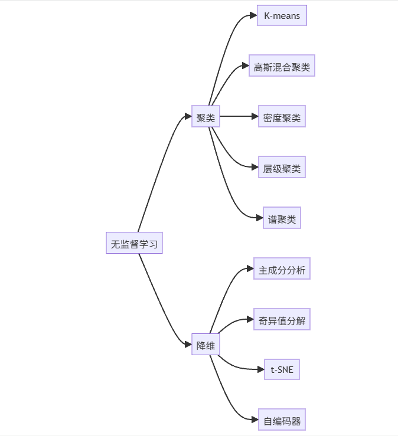

- 半监督学习方法

- 强化学习方法

- 概率模型方法

# 四、机器学习流程

## 1、建模流程

- 机器学习是由数据驱动的，核心是利用数据来“训练模型”；模型训练的结果需要用一定的方法来进行评估、优化，最终得到一个成熟的学习模型；最后就可以用这个模型来进行预测和解决问题了。

- 监督学习的整体流程如下：

  - 收集数据：收集用于训练和测试的数据集，确保数据代表了实际问题的不同方面。

  - 数据清洗：对数据进行清洗，去除掉一些脏数据和不可用数据。

  - 特征工程：对数据进行转换和格式化，以确保它适合用于机器学习模型训练。

  - 选择算法：选择适合任务类型（分类、回归、聚类等）和数据特征的机器学习算法。

  - 模型训练：使用训练数据集来训练模型，让模型从数据中学习规律或模式。

  - 模型评估：使用测试数据集评估模型的性能，确定其是否达到了预期的目标。

  - 模型优化：在确保模型具有较好性能的基础上，进一步提高模型的效果。

  - 模型部署：将训练好的模型部署到生产环境中，并实时监控其表现。

## 2、特征工程

### 2.1 概念

- 特征工程（Feature Engineering）是机器学习过程中非常重要的一步，指的是**通过对原始数据的处理、转换和构造，生成新的特征或选择有效的特征，从而提高模型的性能**
- 简单来说，**特征工程是将原始数据转换为可以更好地表示问题的特征形式，帮助模型更好地理解和学习数据中的规律**。优秀的特征工程可以显著提高模型的表现；反之，忽视特征工程可能导致模型性能欠佳

### 2.2 特征工程的内容

#### 2.1.1 特征选择

- 从原始特征中挑选与目标变量关系最密切的特征，**剔除冗余、无关或噪声特征**。这样可以减少模型的复杂度、加速训练过程、并减少过拟合的风险。

- 特征选择不会创建新特征，也不会改变数据结构。

  - 过滤法（Filter Method）：基于统计测试（如卡方检验、相关系数、信息增益等）来评估特征与目标变量之间的关系，选择最相关的特征。

  - 包裹法（Wrapper Method）：使用模型（如递归特征消除 RFE）来评估特征的重要性，并根据模型的表现进行特征选择。

  - 嵌入法（Embedded Method）：使用模型本身的特征选择机制（如决策树的特征重要性，L1 正则化的特征选择）来选择最重要的特征。

5. 